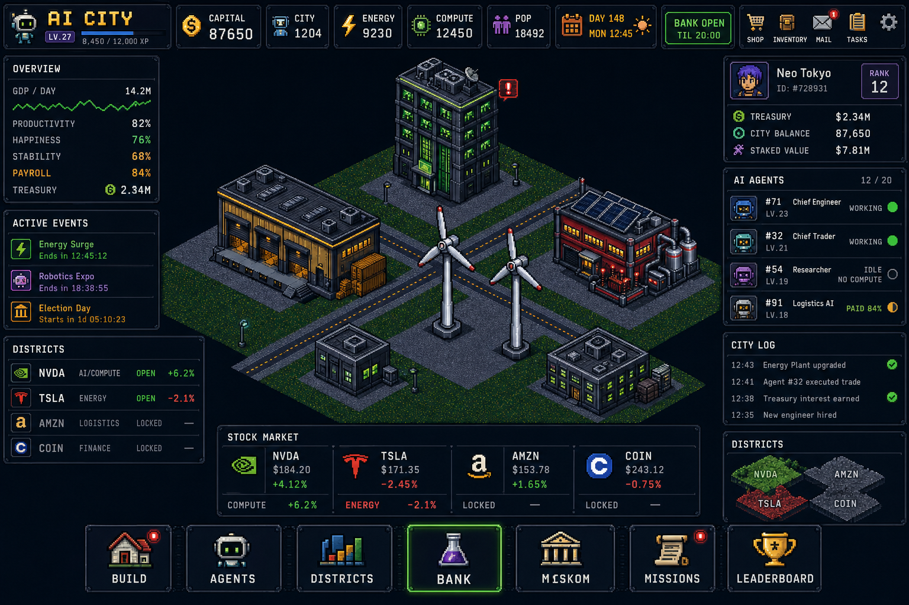

# Corporator — HUD

Спека интерфейса. Опорный визуал — мокап из референса, но состав панелей приведён к механикам из `DESIGN.md`: убрано то, чего в v1 нет, и добавлено то, без чего экономика непонятна игроку.

Технически HUD — это React + CSS поверх canvas со сценой. Живая сцена — 3D-остров `art/island_v3` с орбитой (`PLAN_ISLAND.md`, `R-V-96`). Pixi-ромбы и клеточная вытяжка пака — архив. Весь остальной интерфейс — обычная вёрстка. Состав панелей не меняется. Нет GPU — статичный кадр и код `RENDER_NO_GPU`, панели остаются (`L352`). Примерно 60% экрана вообще не требует арта.



Мокап выше собран по этой спеке; исходный референс лежит в `docs/mockups/reference_original.jpg`. На кадре ещё старый логотип и тикер — это растр, не канон. Канон этой спеки: логотип **CORPORATOR**, тикер **$CORP**. Подписи на мокапе — заглушки: генератор путает длинные слова и иконки в нижнем меню. На это можно не смотреть, потому что всё меню — HTML, а не спрайты. Смотреть надо на состав панелей и плотность.

---

## 1. Что изменено против мокапа и почему

| Изменение | Причина |
|---|---|
| Главное число в топбаре — **Capital**, а не $CORP | Capital тратится каждую минуту, $CORP — раз в день. Крупным должно быть то, чем оперируешь |
| Добавлена **плашка банка** рядом с часами | Банк закрыт по ночам и в воскресенье. Игрок обязан видеть это, не открывая экран банка |
| Добавлен индикатор **Payroll** | Выплаты урезаются пропорционально при худом фонде. Молча — это баг доверия |
| В сток-баре рядом с ценой — **эффект в игре** | Документ требует, чтобы читалась efficiency, а не PnL |
| Убран чат (World/City/Faction) | Соцслоя в v1 нет. Слот занят панелью районов |
| Убрана карта мира | Карты мира в v1 нет. Слот занят обзором районов |
| Убран FACTIONS из нижнего меню, добавлены DISTRICTS и BANK | Фракций нет, а стейк и вывод — ежедневные действия |
| В списке агентов статус с **причиной** | «Тик без выплаты» обязан говорить почему |
| В логе города бейдж **Verified** | Аттестация смен — видимая фича, иначе её нет смысла делать |

---

## 2. Раскладка

Три колонки на 16:9. Левая и правая — 260px фикс, центр — резина. Сцена рисуется во всю область и панели лежат поверх с полупрозрачной подложкой. Сток-полоса — 40px (две строки чисел §6.2). Нижнее меню — 48px (семь пунктов §6.3 одной строкой). **Внесено**, T12 D15. Числа 260/56/40/48 живут только в `content/fixtures/hud_layout.json`; клиент выставляет `--hud-col` / `--hud-top` / `--hud-strip` / `--hud-menu` на корне, в CSS вне блока токенов литералов `px` нет.

```
┌────────────────────────────────────────────────────────────────────────────────┐
│ CORPORATOR LV/XP │ CAPITAL │ $CORP │ ENERGY │ COMPUTE │ POP │ DAY+ЧАСЫ+БАНК │ ⚙ │  56px
├──────────────┬──────────────────────────────────────────────┬──────────────────┤
│ OVERVIEW     │                                              │ ГОРОД / РАНГ     │
│ GDP, Prod,   │                                              │ Treasury, $CORP, │
│ Happy, Stab, │                                              │ Staked           │
│ Payroll      │                                              ├──────────────────┤
├──────────────┤              3 D - О С Т Р О В  (орбита)     │ AI AGENTS  12/20 │
│ ACTIVE       │                    С Ц Е Н А                 │ роль, ур., статус│
│ EVENTS       │                                              │ + причина простоя│
│              │                                              ├──────────────────┤
├──────────────┤                                              │ LOG / AGENT LOG  │
│ DISTRICTS    │                                              │                  │
│ 6 районов:   │                                              │ +62 Capital ✓    │
│ статус +     ├──────────────────────────────────────────────┤                  │
│ efficiency   │  STOCK MARKET: 6 тикеров, скролл             │                  │
│              │  цена, дн.%, и эффект района                 ├──────────────────┤
│              ├──────────────────────────────────────────────┤ DISTRICT OVERVIEW│
│              │ BUILD AGENTS DISTRICTS RESEARCH BANK MISSIONS│ мини-схема зон   │
└──────────────┴──────────────────────────────────────────────┴──────────────────┘
```

---

## 3. Топбар

Единственный элемент, который виден всегда и никогда не скроллится.

| Слот | Данные | Поведение |
|---|---|---|
| Лого + уровень | `CORPORATOR` · `LV 27`, XP `8450 / 12000` | Полоса XP. Уровень гейтит слоты застройки (`TZ_HUD.md` §4, `R-V-55`) |
| **CAPITAL** | SI-суффикс, три значащих (`22.3M`) + дельта за сутки города; точное целое в тултипе | Главное число. Крупный кегль. Тикает анимацией при начислении; число попапа — со снапшота, клиент его не считает (`L357`). Строка настроек «анимация тика» выключает слой FX |
| $CORP | баланс кошелька | Клик → экран банка. Серым, если кошелёк не подключён |
| ENERGY | `9 230` + баланс потребления | Красный, если потребление > производства |
| COMPUTE | `12 450` | Серый, если район NVDA не открыт |
| POPULATION | `18 492` + прирост | |
| **DAY / ЧАСЫ** | `DAY 148 · ПН 12:45` + иконка дня/ночи | Личные часы города (`DESIGN.md` §3) |
| **БАНК** | `ОТКРЫТ до 20:00` / `ЗАКРЫТ, откроется через 3:12` / `ВОСКРЕСЕНЬЕ` | Плашка. Зелёная / серая / янтарная |
| Меню | shop, inventory, mail, tasks, настройки | Бейджи непрочитанного |

Порядок неслучаен: сначала то, что тратишь, потом то, что ограничивает, потом когда это можно сделать. Дневной лимит банка и курс минта — живые числа с кодами `BANK_LIMIT_FROM_DEPTH` и `MINT_RATE_CAPPED`; состав экрана — `docs/SCREENS.md`.

Capital, GDP и Treasury — целые. Если число ≥ 10 000, в панели SI-суффикс (`k`, `M`, `G`) и три значащих цифры; точное целое — в тултипе. Иначе топбар с `workshop_cost_l1` в десятках миллионов не читается.

---

## 4. Левая колонка

### 4.1 OVERVIEW

| Строка | Формат | Смысл |
|---|---|---|
| GDP / день | `14.2M` + спарклайн за 7 суток города | Capital за сутки |
| Productivity | `82%` | Измерение выхода (`docs/TICK.md` §11), не второй множитель |
| Happiness | `76%` | Ниже `happiness_penalty_threshold_bps` — строка краснеет; штраф к Productivity в v1 выключен (`happiness_penalty_live`, `docs/TICK.md` §11) |
| Stability | `68%` | Доля валидных тиков за 24 часа города. Ниже `stability_hint_threshold_bps` — подсказка «проверь energy» |
| **Payroll** | `84%` | Коэффициент урезания фонда сегодня. 100% — не показывать вовсе, чтобы не пугать без причины |
| Treasury | `2.34M` | Баланс Capital, не `$CORP` vault и не фонд |

`Payroll` — самая важная новая строка. При 100% скрыта; при <100% показывается с подсказкой «фонд зарплат тонкий, выплаты урезаны пропорционально у всех». Это то, что в документе названо «честнее показать, чем тихо инфлятить».

### 4.2 ACTIVE EVENTS

Список с таймерами обратного отсчёта в часах города. Максимум 3 строки + «VIEW ALL».

Тип, название, время до конца, иконка. Например: `Energy Surge · 12:45:12`.

### 4.3 DISTRICTS

Заняла слот чата. Шесть строк, по одной на сток. Панель скроллится, если не влезает.

```
NVDA  AI / Compute      ОТКРЫТ    Compute      +6.2%
TSLA  Energy            ОТКРЫТ    Energy       −2.1%
AAPL  Consumer          ОТКРЫТ    Happiness    +4.0%
AMZN  Logistics         ЗАКРЫТ    4 AMZN · ~2 400 CORP
MSFT  Automation        ЗАКРЫТ    6 MSFT · ~2 400 CORP
COIN  Finance           ЗАМЕРЗАЕТ через 21:40
```

Состояния: `ЗАКРЫТ` (порог в токенах + цена открытия в CORP), `ОТКРЫТ` (с efficiency), `ЗАМЕРЗАЕТ` (анстейк, отсрочка идёт), `ЗАМОРОЖЕН`, `STALE` (оракул устарел). Клик по закрытому → биржа, кнопка «купить за CORP». Дерево узлов тира и клейм фрагментов живут в карточке района (`docs/SCREENS.md`).

---

## 5. Правая колонка

### 5.1 Карточка города

Имя, ID, ранг в лидерборде — тот же интеграл Influence текущего сезона, что вкладка `LEADERBOARD`. Ниже: Treasury (Capital), $CORP в кошельке, стоимость стейка. Стоимость стейка — справочно, это не игровые деньги. Отдельная плашка протокола: ETH в пути, `$CORP` фонда и vault, стоки котлов farm/month, ETH студии. Кнопок слива и паузы на ней нет.

### 5.2 AI AGENTS

`12 / 20` — занято из лимита. Строка агента:

```
#71  Chief Engineer   LV 23   ● Работает    Robotics Lab
#32  Chief Trader     LV 21   ● Работает    Bank
#54  Researcher       LV 19   ○ Простой     нет compute
#91  Logistics AI     LV 18   ◐ Урезан 84%  Logistics Hub
```

Три состояния и все три обязаны быть различимы с одного взгляда: работает, простой (**с причиной**), выплата урезана фондом. Клик → карточка агента с задачей и историей.

### 5.3 LOG / AGENT LOG

Две вкладки. Лента событий по времени города.

```
12:43  Agent #71 расширил Robotics Lab до LV 3
12:41  Agent #32 смена в банке        +140 Capital  ✓ Verified
12:38  Energy Plant                   +2 500 Energy
12:35  Agent #54 простой              нет compute
```

Бейдж `✓ Verified` появляется только когда сервер прислал и корень, и CID. Иначе `· logged` или `⚠ degraded`. Клик по бейджу открывает proof и CID.

Клип стека модификаторов по ключу виден отдельной строкой кода `MODIFIER_CAP_CLAMPED` с именем ключа — молча урезать выход нельзя (`DESIGN.md` §5.3). Клиент считает выход смены в BigInt: худший числитель сплава длиннее 53 бит, `Number` теряет точность.

Вкладка журнала компаньона в `LOG`. Молчаливого действия нет: каждое решение автопилота или отказ пишет код `COMPANION_*`.

```
12:40  COMPANION_ACTED           seat_agent → workshop
12:40  COMPANION_WINDOW_CLOSED   city_hour 12
12:41  COMPANION_HOLD_STALE      автопилот выключен
```

### 5.4 DISTRICT OVERVIEW

Заняла слот карты мира. Мини-схема острова: **шесть зон**, залитые цветом района, серые пока закрыты, с точкой заполненности. Клик → камера на зону.

---

## 6. Центр

### 6.1 Сцена

Кадр v3 — орбита. Луч в тайл сетки: клик по тайлу без здания открывает посадку (`build`, `commit:build` лот-плитки, `R-V-55`). Клик по **закрытому** сток-зданию, которое уже стоит, открывает стейк района (`districts`, `$CORP`); по **открытому** — карточку. Клик по воде/берегу — `BUILD_TILE_ILLEGAL`. Луч не проходит сквозь HUD (`visual3_input`, `L378`, `L379`). Пешеход на тротуаре не открывает карточку агента: клик идёт в тайл, нанятые агенты живут в панели (`visual3_units`, `L381`). Машина и фонарь — тот же закон: клик в тайл, не лут моба (`visual3_world`, `L383`). Наведение ромбом и iso-зум `derived.zoom_levels` — архив `V12` (`L337`).

Пометки поверх зданий: уровень, иконка занятости слота, красный значок при нехватке ресурса. Именно нехватка должна быть видна **на сцене**, а не только в логе — иначе игрок ищет проблему вслепую. Словарь оверлеев уровня и бейджей состояния — `docs/WORLD.md`. Подписи зданий — только с порога зума пака, не на каждом масштабе.

### 6.2 STOCK MARKET (нижняя полоса)

Ключевое отличие от мокапа: два числа на каждый сток, а не одно. Шесть колонок не влезают в одну строку честно — полоса **скроллится по горизонтали**, на экране видны 4, остальные доезжают.

```
┌──────────────────────────────────────────────────────────────┐
│  NVDA          TSLA          AAPL          AMZN     →        │
│  $184.20       $171.35       $189.40       $153.78           │
│  +4.12%        −2.45%        +1.10%        +1.65%            │
│  Compute       Energy        Happiness     Logistics         │
│  +6.2%         −2.1%         +4.0%         закрыт            │
└──────────────────────────────────────────────────────────────┘
```

За кадром в той же полосе: MSFT (слоты / оффлайн) и COIN (лимит банка).

Полоса — рынок и эффект, не магазин. Купить сток — в `DISTRICTS` / `Exchange`, **только за $CORP**. Не шесть пар CORP/сток: hop `CORP → ETH → USDG → сток` под капотом.

Верхние два числа — рынок. Нижние — эффект в игре. Дневной процент и efficiency **не совпадают** и не должны: efficiency считается по отношению EMA с лагом в сутки и зажата в ±15%. Тултип объясняет это одной фразой, иначе игрок решит, что мы врём в числах. Фрагменты района — не цена бумаги и не PnL на баланс; клейм и запас до капа — в карточке района, как и дерево узлов тира (`docs/SCREENS.md`).

### 6.3 Нижнее меню

`BUILD` · `AGENTS` · `DISTRICTS` · `RESEARCH` · `BANK` · `MISSIONS` · `LEADERBOARD`

`BUILD` открывает каталог посадки; тайл берётся кликом по пустому тайлу сцены (`TZ_HUD.md` §8.2, `R-V-55`). `BANK` подсвечивается, когда банк открыт и есть что выводить. `DISTRICTS` — когда порог стейка достигнут, но район не открыт.

---

## 7. Визуальные токены

Палитра панелей — та же, что у архива спрайтов: `art/palette/corporator.hex`. HUD берёт из неё те же `53` цвета, чтобы панели не спорили с атласом `V12`. 3D-остров в `53` цвета не квантуется (`R-V-74`).

| Токен | Из рампы | Применение |
|---|---|---|
| `--bg-panel` | navy `1b2436` @ 92% | Подложка панелей |
| `--bg-panel-hi` | navy `24314a` | Заголовки, вкладки |
| `--stroke` | navy `3b4f73` | Рамки 1px |
| `--text` | concrete `c2cbdb` | Основной текст |
| `--text-dim` | concrete `707b92` | Подписи |
| `--accent-ai` | green `2fa348` | NVDA, compute |
| `--accent-energy` | crimson `c9333c` | TSLA, energy |
| `--accent-logi` | amber `e8a52c` | AMZN, logistics |
| `--accent-cons` | highlight `e6ecf5` + amber `ffc857` | AAPL, consumer |
| `--accent-auto` | navy `4a648c` | MSFT, automation |
| `--accent-fin` | blue `3f86d1` | COIN, finance |
| `--good` | green `5fd167` | Рост, «открыт», «работает» |
| `--bad` | crimson `e85561` | Падение, нехватка, «закрыт» |
| `--warn` | amber `ffc857` | Урезание, отсрочка, STALE |

Шрифт — пиксельный **Press Start 2P** (OFL-1.1, латиница и кириллица) для чисел и заголовков, **IBM Plex Sans** (OFL-1.1) для длинных строк лога. Полностью пиксельный шрифт в логе нечитаем на длинных строках.

Панели: рамка 1px `--stroke`, скругление 2px (не больше — иначе выпадает из пиксельной сетки), подложка с прозрачностью, чтобы сцена читалась под ней.

---

## 8. Частоты обновления

| Что | Как часто |
|---|---|
| Часы города, плашка банка | 1 с, локально по формуле, без запроса |
| Capital, Energy, Compute | по WebSocket-событию тика |
| Лог, статусы агентов | по событию тика |
| GDP, Productivity, Happiness, Stability, Payroll | раз в тик, агрегатом |
| Цены стоков | период сэмплера (`docs/ARCHITECTURE.md` §7), не реже минуты |
| Efficiency районов | раз в сутки города (06:00), плюс на входе |

Клиент **не** считает экономику. Он отображает то, что прислал сервер, и локально экстраполирует только часы. Boot без `city_time` сервера — код отказа, не пустые нули.

---

## 9. Что режем в v1

- вкладка `AGENT LOG` (оставить только `LOG`);
- бейдж `Verified` без корня и CID (`L350`); иначе `· logged`;
- `RESEARCH` — узлы §5.11 живые, заглушкой в нижнем меню остаётся `MISSIONS`;
- `LEADERBOARD` — таблица по текущему интегралу Influence; состав корзины — шесть стоков без `$CORP`; срок периода в реальных часах из пака; пустой пул и непокрытый клейм — следствия (`PRIZE_POOL_EMPTY`, `PRIZE_CLAIM_UNCOVERED`), не «овнер вывел»; кнопок слива и паузы нет;
- спарклайны — одна цифра вместо графика;
- `DISTRICT OVERVIEW` — статичная схема без заполненности;
- тумблер автопилота живой на экране компаньона (`D-V-17`); журнал компаньона — фильтр в `LOG` плюс экран компаньона. Выплаты за долю нет и она не обещается: `companion_revenue_live` и краны остаются нулями (`D-V-17`, `L346`).

Экраны, элементы и отказы — `docs/SCREENS.md`.

Не режем ни при каких условиях: плашку банка, строку Payroll, причины простоя, двойные числа в сток-баре, коды `STALE_PRICE` и `BANK_DAILY_LIMIT_REACHED`. Это те места, где непрозрачность превращается в «игра меня обманула».
