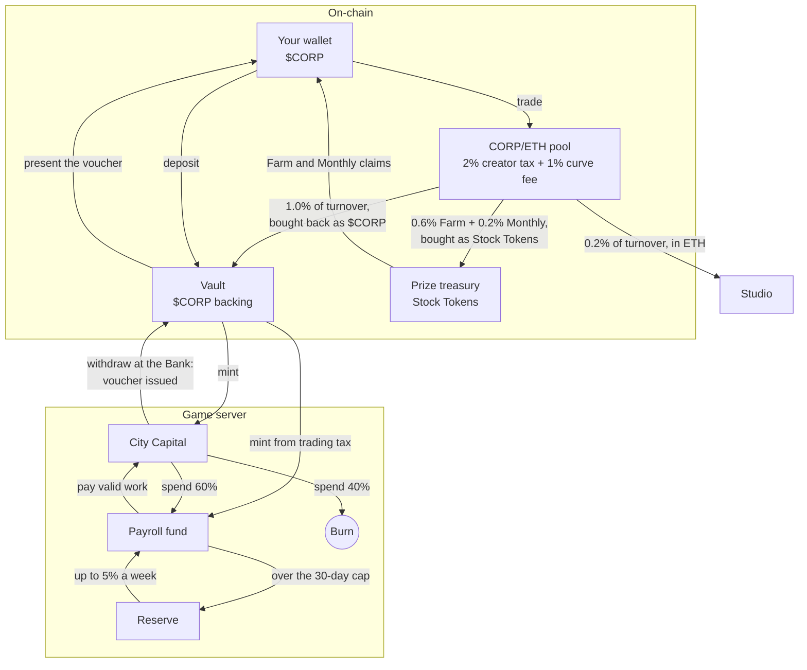
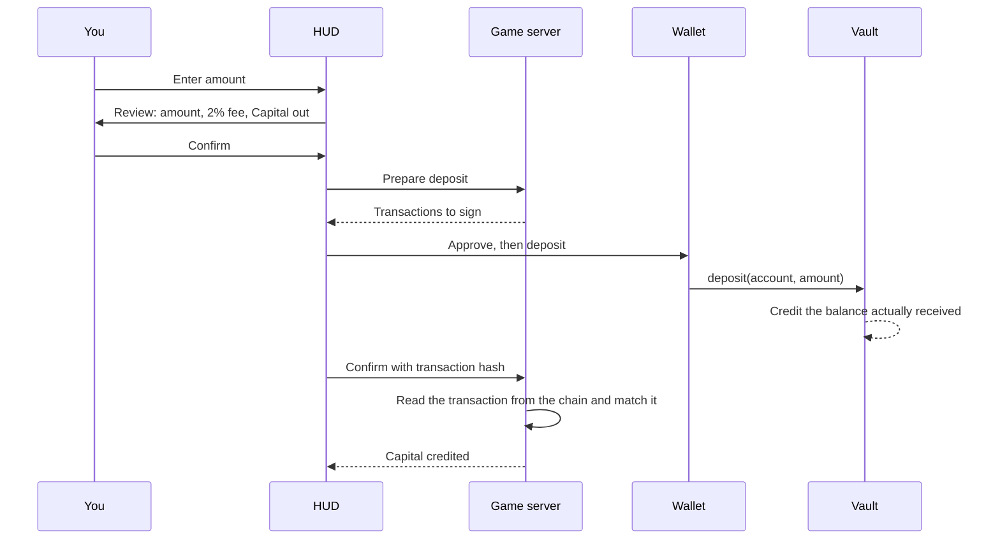

# Economy

The economy has two sides. On-chain, `$CORP` sits in a vault. On the game server, Capital moves between cities and one shared Payroll fund. A single rule links the sides: no Capital can exist that the vault's `$CORP` doesn't back.

## Units

| Unit | Kind | Created by | Removed by |
|---|---|---|---|
| `$CORP` | ERC-20 on Robinhood Chain | The token launch, fixed supply | — |
| Capital | Internal chips. Not a token, not transferable. | Minting against `$CORP` deposited in the vault | The 40% spending burn and Bank withdrawals |
| Fragments | Internal claim ledger, one per district | Work in district beacons | Each Farm settlement |
| Influence | Prize-period score | Daily city results | Each prize settlement |
| Stock Tokens | Third-party tokenised shares | Their issuers, not Corporator | — |

## How value moves

Two things bring value into the city side:

1. **Deposits.** You move `$CORP` into the vault and receive Capital.
2. **Trading tax.** Half of the 2% creator tax, 1% of turnover, is bought back as `$CORP`, deposited in the vault and minted into the Payroll fund.

Two things take it out:

1. **The spending burn.** 40% of every Capital spend is destroyed. The `$CORP` that backed it stays in the vault.
2. **Bank withdrawals.** Capital converts back to `$CORP` at a markup, and the `$CORP` leaves the vault for your wallet.

Everything else circulates. You spend, spending fills Payroll, Payroll pays cities, and cities spend again.

## The `$CORP` token

| | |
|---|---|
| Network | Robinhood Chain, chain ID `4663`, gas in ETH |
| Launch | Through the pons launch factory: a bonding curve that graduates into one CORP/ETH pool |
| Supply | 1,000,000,000 |
| Graduation | 4.2 ETH |
| Creator tax | 2% of each trade, in ETH |
| Curve fee | 1% |
| Total fee per trade | 3% |
| Pools | One: CORP/ETH. There's no CORP/USDG pool and no pool against any Stock Token. |
| Address | Not deployed. See the [deployment register](protocol.md#deployment-register). |

The creator tax splits like this:

| Destination | Share of turnover | Share of the tax |
|---|---:|---:|
| Payroll fund: bought back as `$CORP`, deposited, minted into the fund | 1.0% | 50% |
| Farm pool: Stock Tokens for [fragment settlement](seasons.md#fragments-and-the-farm) | 0.6% | 30% |
| Monthly pool: Stock Tokens for [leaderboard prizes](seasons.md#monthly-prizes) | 0.2% | 10% |
| Studio | 0.2% | 10% |

## The mint rate

The mint rate $r$ is how much Capital one whole `$CORP` buys. It follows the `$CORP` market price, with one Capital defined as \$0.000001:

$$
r_{\text{raw}} = \frac{P_{\text{CORP}}}{\$0.000001}
$$

$P_{\text{CORP}}$ is the `$CORP` price in dollars, taken from the CORP/ETH pool and the ETH/USD price. So 1,000,000 Capital is about \$1 of `$CORP` at the current rate. That's a unit convention, not a promise that you can redeem at that price.

The rate you actually get is damped:

| Rule | Value |
|---|---|
| Reference | Average of the daily 00:00 samples over the last 30 city days |
| Band | Within ±15% of the reference |
| Falling | Applies at once |
| Rising | At most +2% per city day |
| Hard ceiling | 2,000 Capital per `$CORP` |
| Spike limit | 3× the reference (`MINT_RATE_CAPPED`) |
| Stale price, over 6 city hours | Decays by 5% per city day |
| No usable price | Nothing mints. Deposits refuse with `STALE_PRICE`. |

At the start, before price samples move it, the rate is **51**. The examples below use that value.

### The backing rule

$$
\sum_{\text{cities}} \text{Capital} + \text{Payroll fund} \;\le\; \text{vault } \$\text{CORP} \times 2000
$$

This holds because every Capital mint goes through `$CORP` deposited in the vault, and the 2,000 ceiling is fixed arithmetic, not a price feed. The vault contract itself refuses to mint more than 2,000 Capital per `$CORP` deposited. The server checks the rule every tick and halts the tick rather than break it. Nothing mints Capital to cover a shortfall.

## Depositing

$$
C = \left\lfloor \frac{c \cdot r}{10^{18}} \right\rfloor \times \frac{9800}{10^4}
$$

- $c$: `$CORP` deposited, in wei (18 decimals).
- $r$: the current mint rate.
- 9,800: what's left after the 2% entry fee. The fee's `$CORP` stays in the vault as reserve backing and mints no Capital.

**Example.** At a rate of 51, depositing 1,000,000 `$CORP` gives 51,000,000 Capital before the fee, and **49,980,000 Capital** after it. The 20,000 `$CORP` fee joins the reserve.

The vault credits the `$CORP` it actually received, not the amount named in the call. Only the account being credited can make the deposit. Deposits don't depend on Bank hours.

## Spending Capital

Every spend (opening and upgrading buildings, hiring, research, tiers, merges) splits the same way:

| Share | Goes to |
|---:|---|
| 40% | Burned |
| 60% | Payroll fund |

Spending never buys Stock Tokens and never pays the studio.

## Payroll

Payroll pays the requests that working seats file each tick ([How a seat earns](agents.md#how-a-seat-earns)). There's one fund for all cities.

### The daily budget

At 00:00 city time the next day's budget is fixed:

$$
B_{\text{day}} = \max\!\left(\left\lfloor \frac{F}{14} \right\rfloor,\ \bar I_{3}\right), \qquad B_{\text{tick}} = \left\lfloor \frac{B_{\text{day}}}{24} \right\rfloor
$$

- $F$: the fund balance at 00:00. Dividing by 14 spreads it over a 14-day horizon.
- $\bar I_{3}$: the average daily inflow into the fund over the last 3 city days.

The budget holds for the whole day, even if more inflow arrives before the next midnight.

### Each tick's pool

$$
P = \min\!\left(\left\lfloor \frac{b \cdot \sum_i R_i}{10^4} \right\rfloor,\ B_{\text{tick}},\ F\right), \qquad \rho = \frac{P \cdot 10^4}{\sum_i R_i}
$$

| Symbol | Meaning |
|---|---|
| $R_i$ | Each working seat's request, across every city |
| $b$ | The boost: ×8 (80,000 bps) for the first 7 city days after launch, then ×3 (30,000 bps) |
| $P$ | Capital paid out this tick |
| $\rho$ | The pay ratio, which can exceed 100% |

The pool is shared in proportion to requests, with each request weighted by its city's fund share $s$ (from the Finance dividend and the Clearing House, up to 3,500 bps): $R_i \times (10^4 + s) / 10^4$. Without fund share, a seat is paid $R_i \times \rho$, rounded down.

Because the cut is proportional, nobody gets zero while the fund holds Capital. When $\rho$ drops below 100%, the HUD shows `PAYROLL_TRIMMED` and the ratio used. During the launch window, a chip shows the boost and the days left, and it disappears when the window closes.

**Example.** Suppose the fund holds 336,000,000 Capital, so $B_{\text{day}}$ = 24,000,000 and $B_{\text{tick}}$ = 1,000,000. The boost is ×3 and no city has fund share. Take the 155,762 request from the [seat example](agents.md#how-a-seat-earns):

| All requests $\sum R$ | Boosted | Pool $P$ | Ratio $\rho$ | The 155,762 request gets |
|---:|---:|---:|---:|---:|
| 200,000 | 600,000 | 600,000 | 300% | 467,286 |
| 500,000 | 1,500,000 | 1,000,000 | 200% | 311,524 |
| 2,000,000 | 6,000,000 | 1,000,000 | 50% | 77,881 |

The same work earns six times more in a quiet tick than in a crowded one. These are sample inputs, not a forecast.

### Fund limits

- **Cap.** The fund holds at most 30 days of its average spend. Anything above that goes to the reserve.
- **Reserve.** It releases at most 5% of its balance per city week back into the fund. Entry fees land here too.
- **Empty fund.** Seats still work and record it, but they're paid nothing. Nothing mints to fill the gap.

A payment moves Capital from the fund to your city. Payroll never creates Capital.

## The Bank

The Bank turns Capital back into `$CORP`.

$$
c_{\text{out}} = \frac{K \cdot 10^{18} \cdot 10^4}{r \cdot (10^4 + m)}
$$

- $K$: Capital withdrawn.
- $r$: the current mint rate.
- $m$: the markup in bps. Every withdrawal in the current version uses 1,000 (10%).
- $c_{\text{out}}$: `$CORP` out, in wei.

**Example.** At a rate of 51, withdrawing 10,000,000 Capital at the 10% markup gives $10{,}000{,}000 / (51 \times 1.10)$ ≈ **178,253 `$CORP`**.

At the 2,000 ceiling, the exit rate is 2,200 Capital per `$CORP`. Entry is 1,960 per `$CORP` after the fee. Entering is always cheaper than leaving, and the rules can't be set otherwise.

`[NEEDS CONFIRMATION]` A Trader on the Desk task in your Bank is meant to lower the markup to its 650 bps (6.5%) floor. Withdrawals don't apply it yet. At the floor, the exit rate would be 2,130 Capital per `$CORP` and the round trip 11.64%.

### Hours and limits

| Rule | Value |
|---|---|
| Hours | 08:00–20:00 city time (`BANK_CLOSED`) |
| Sunday | Closed (`BANK_SUNDAY`) |
| Global daily limit | 5% of the CORP/ETH pool's ETH depth, shared by all players |
| Your daily limit | A share of the global limit, set by your Bank level |
| Coverage | The vault must have free `$CORP` to pay you (`VAULT_EXIT_UNCOVERED`) |
| Demo city | No withdrawals |

Your **Bank level** is the level of your highest Finance Tower that is active: not deactivated, not frozen and not in a frozen district. Without one it's 1.

| Bank level | Share of the global limit | Your limit if the pool holds 4.2 ETH |
|---:|---:|---:|
| 1 | 25% | 0.0525 ETH |
| 2 | 43.75% | 0.091875 ETH |
| 3 | 57.82% | 0.121422 ETH |

With 4.2 ETH in the pool, the global limit is 0.21 ETH a day for everyone together. A request bigger than your remaining room is **partly filled**, scaled down to fit. With no room left you get `BANK_DAILY_LIMIT_REACHED`.

Your deposit doesn't cap your withdrawal. Bank hours, the daily limits and the vault's free coverage do. The vault pays from your own backing first and then from the protocol's house backing.

### Vouchers

A withdrawal reaches your wallet in two steps:

1. **Withdraw.** In the Bank, enter the Capital to withdraw and confirm the review. The Bank checks hours, limits and coverage, takes the Capital from your city and issues a **voucher** that reserves the `$CORP` for you in the vault. You don't sign anything at this step.
2. **Present.** The voucher card shows the `$CORP` amount and when it expires. Press Present and approve the transaction in your wallet. The vault sends the `$CORP` straight to your wallet. You pay the gas in ETH.

| Rule | Value |
|---|---|
| Lifetime | One city hour from the issue |
| Open vouchers | One per city at a time (`VOUCHER_PENDING`) |
| Not presented in time | After the chain read the voucher is expired and the Capital returns to your city (`VOUCHER_EXPIRED`). Until that read, the card waits. It doesn't use up your daily limit. |
| Bank hours | Checked when the voucher is issued, not when you present it |

A voucher is either paid out or returned as Capital, never both. While it is still being issued, Present stays blocked. It stays on the Bank screen after a page reload. If you approved Present but closed the tab, a later chain read completes the withdrawal. [Protocol](protocol.md#vault) shows the contract calls.

## The round trip

Buying `$CORP`, depositing, withdrawing and selling, at the 2,000 ceiling. Every row is valued in `$CORP` at an unchanged pool price:

| Step | Kept, in `$CORP` |
|---|---:|
| Start: ETH worth 10,000 `$CORP` | 10,000 |
| Buy on the DEX (2% creator tax) | 9,800 |
| Deposit (2% entry fee), Capital valued at 2,000:1 | 9,604 |
| Withdraw at 2,200:1 | 8,730 |
| Sell on the DEX (2% creator tax) | 8,555 |
| **Round-trip cost** | **14.45%** |

This is fee arithmetic, not a market forecast. It leaves out the 1% curve fee on each trade, price impact, gas and any price move. The rules keep the fee cost between 14% and 16%, so no fee change can move it outside that band.

## The Exchange

The Exchange buys Stock Tokens with `$CORP` along one route: **`$CORP` → ETH → USDG → Stock Token**.

- It needs a live quote. Without one, the purchase refuses with `EXCHANGE_HOP_UNAVAILABLE`.
- It pays with `$CORP` from your wallet (`NOT_ENOUGH_CORP` if short). Your wallet signs the route transactions, with an approval first if needed, and pays their gas.
- The Stock Tokens go straight to your wallet with no route haircut. The game records the amount that actually arrived, not the quote.
- The tokens aren't staked. Staking is a separate step, and a stake of at least $S_{\min}$ opens the district ([Where your Stock Tokens are](industries.md#where-your-stock-tokens-are)).

Stock Tokens are issued by third parties. A ticker says nothing about the token's rights, transfer limits or redemption terms, and it doesn't mean the company is a partner. Check the issuer's terms.

## What the economy doesn't do

- It doesn't pay you for opening a building. Buildings earn only through the seats that work in them.
- It doesn't pass stock performance to you.
- It doesn't mint Capital beyond what the vault's `$CORP` backs.
- It doesn't promise every city ends up ahead. Payroll is finite and shared.
