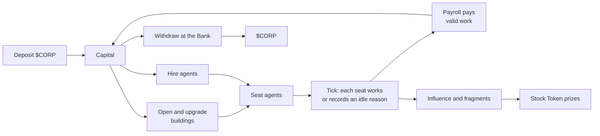

# Getting Started

Corporator is a city-management game on Robinhood Chain. Every player runs one city on the same hand-built island, and every building already stands on it. You open buildings with Capital, seat agents in them and upgrade what works. Once every city hour the game runs a **tick**: each seated agent either works and asks Payroll to pay for that work, or records why it couldn't.

You bring value in by depositing `$CORP` into a vault. You take value out through the Bank, which keeps opening hours and daily limits. Stock Tokens such as NVDA or TSLA open industries and pay out as season prizes.

> **Release status.** Corporator hasn't launched. `$CORP` and the game contracts aren't deployed yet, so these pages describe the rules as they stand before launch. The [deployment register](protocol.md#deployment-register) will list every production address once it exists. Until then, no address is official.

## Three units

| Unit | What it is | Where it lives | Can you trade it? |
|---|---|---|---|
| `$CORP` | The game's ERC-20 token, traded in one CORP/ETH pool | Your wallet or the vault | Yes |
| Capital | The chips you spend in your city: opening buildings, hires, upgrades | Your city's state on the game server | No. It isn't a token and can't be transferred. |
| Stock Tokens | Tokenised shares issued by third parties on Robinhood Chain (NVDA, TSLA, AMZN, AAPL, MSFT, COIN) | Your wallet, staked, or cooling down for 30 city days after an unstake ([details](industries.md#where-your-stock-tokens-are)) | Yes, from your wallet, under the issuer's terms |

Capital comes from two places: a `$CORP` deposit, or Payroll paying your agents' work from a fund that `$CORP` already backs. It leaves your city when you spend it or withdraw it through the Bank. The [Economy](economy.md) page explains the full cycle.

## The core loop

An open building earns nothing on its own. Only a seated agent who works during the building's hours, with its Energy and Compute covered, files a payment request. Payroll then pays that request from a shared, finite fund.

## What you need

| To play | You need |
|---|---|
| A demo city | A browser. No wallet, no deposit. Progress doesn't carry over, and you can't withdraw or claim prizes. |
| A wallet city | A wallet on Robinhood Chain (chain ID `4663`), ETH for gas, and `$CORP` to deposit |
| An industry | Its Stock Token, staked from your wallet. For example, NVDA opens Compute. See [Industries](industries.md). |

To sign in, you sign a login message. That opens a session and nothing else: it doesn't approve tokens or move funds.

## Your first session

A minimal working city costs 73,499,998 Capital:

| Item | Capital | Why |
|---|---:|---|
| Workshop, level 1 | 34,217,877 | Your first Capital producer |
| Power Node, level 1 | 11,291,899 | Makes the Energy the Workshop draws |
| Agent Hub, level 1 | 17,108,938 | With a Scientist seated, adds a +10% link to the Workshop |
| First hire | 5,132,681 | |
| Second hire | 5,748,603 | Each hire costs more than the last |

1. **Deposit.** Open the Bank (key `4`). The Review screen shows the `$CORP` amount, the 2% entry fee and the Capital you'll get. Nothing leaves your wallet until you confirm and sign.
2. **Open buildings.** Click the Workshop on the island and open it from its card. It starts working after one tick. Then open the Power Node and the Agent Hub.
3. **Hire.** A random hire is an Engineer (50%), a Logistician (25%) or a Trader (25%). You can also choose a role for the same price.
4. **Seat.** Put an Engineer in the Workshop and another in the Power Node. Only an Engineer makes Energy. A Logistician in the Power Node lowers Energy costs but makes none.
5. **Watch a tick.** The Journal (key `6`) shows each seat's result. A paid seat shows its payment. An idle seat shows a code that names what's missing, such as `IDLE_NO_ENERGY`.

## Rules to know on day one

- **Payroll is shared.** Every city is paid from one fund. When requests outgrow the fund's budget, every payment is scaled by the same ratio. See [Payroll](economy.md#payroll).
- **The Bank keeps hours.** Withdrawals run 08:00–20:00 city time and stop on city Sundays. Deposits work at any hour.
- **Offline time is capped.** Your city keeps working for 12 city hours after you leave, or up to 18 with upgrades. Later hours are skipped, not saved.
- **City Level never drops.** Once reached, it stays.
- **Industry choices are final.** Nodes and merges can't be undone. The HUD asks you to confirm first.

## The HUD

The island stays on screen, with the HUD over it.

| Key | Workspace | What you do there |
|---|---|---|
| `1` | Overview | City metrics, Payroll state, research |
| `2` | Agents | Hire, open an agent card, assign a seat, set a task |
| `3` | Exchange | Buy a Stock Token with `$CORP` |
| `4` | Bank | Deposit `$CORP`, withdraw Capital |
| `5` | Industries | Stake, open districts, unlock tiers, pick nodes, merge, claim fragments |
| `6` | Journal | Shift records, events, verification status |

Click a building to see its card: level, workers, output, and the open, upgrade and on/off buttons. The `$CORP` chip in the top bar opens your wallet panel, and the season plaque opens rankings and prizes.

When an action can't run, its button shows the reason code, such as `NOT_ENOUGH_CAPITAL` or `BANK_CLOSED`. A value the server hasn't sent shows as `—`, never as a guess. All codes are in the [Reference](reference.md#codes).

## Reading the numbers

- Rates are in **basis points** (bps): 10,000 bps = 100%, so 200 bps = 2%.
- Capital is counted in whole units. The HUD may shorten large amounts, for example `34.2M`.
- Every number on these pages comes from one versioned rule set, the **rules pack**. See [Versions](reference.md#versions).
- Examples show arithmetic under stated inputs. They aren't forecasts.

Corporator doesn't promise a return. `$CORP` and Stock Tokens can lose value, Payroll can pay less than you asked for, and the Bank limits when and how much you can withdraw. Read [Risks](protocol.md#risks) before you deposit.
