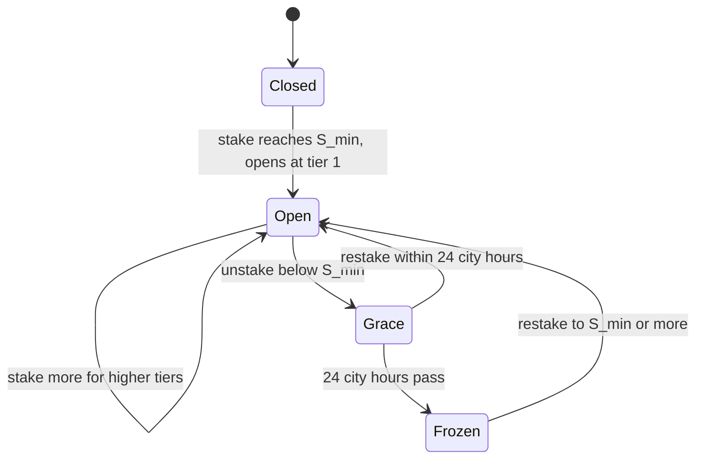

# Industries and Progression

Beyond opening more buildings and hiring more agents, you grow along four tracks. All of them draw on the same Capital.

| Track | What you get | What it takes |
|---|---|---|
| Districts | A beacon building, automatic dividends, a node choice at each tier | A Stock Token stake |
| Synergies | Six buildings that combine two districts | Building slots and Capital |
| Merges | A second copy of two districts' tier-1 dividends, for pairs without a synergy | Both districts at tier 2 |
| Research | Five city-wide upgrades | Capital and a Scientist's time |

## The six districts

Each district is tied to one Stock Token. The district's role is fixed. The ticker behind it can change in a future rules version.

| District | Ticker | Beacon | Dividend at tier 1 / 2 / 3 | Minimum stake $S_{\min}$ |
|---|---|---|---|---:|
| Compute | NVDA | AI Research Center | Compute cost −5% / −10% / −15% | 0.458389 NVDA |
| Energy | TSLA | Energy Plant | Energy cost −5% / −10% / −15% | 0.287058 TSLA |
| Logistics | AMZN | Logistics Hub | Logistics relief +5% / +10% / +15% | 0.375820 AMZN |
| Consumer | AAPL | Flagship Store | Population conversion +5% / +10% / +15% | 0.312781 AAPL |
| Automation | MSFT | Cloud Campus | Offline hours +1 / +2 / +3 | 0.194947 MSFT |
| Finance | COIN | Finance Tower | Payroll fund share +5% / +10% / +15% | 0.562693 COIN |

$S_{\min}$ is set in tokens, not dollars. Each value was worth about \$100 at a price snapshot taken on 2026-08-29 and was then frozen, so it doesn't follow the stock price. The table rounds to six decimals. The rules store the exact 18-decimal amounts.

Finance matters for your exits and your income: the Finance Tower sets your [Bank level](economy.md#hours-and-limits), and the Finance dividend raises your share of Payroll.

## Staking

- **Open a district.** Stake at least $S_{\min}$ of its token from your wallet. The stake itself opens the district at tier 1 with its tier-1 dividend, with no separate step. Opening costs no Capital, and demo cities can't open districts.
- **Stake more.** Each stake raises your total to the next whole multiple of $S_{\min}$. Higher tiers need 2× and 3×.
- **Unstake.** You can request your tokens back at any time, with no one's approval, and the amount stops counting as stake at once. If what's left falls below $S_{\min}$, the district enters a **24-city-hour grace period** (`DISTRICT_FREEZING`) and then **freezes**. Its beacon and any synergy building that needs it stop with `IDLE_DISTRICT_FROZEN`, and its nodes stop counting. Nothing is demolished, and restaking lifts the freeze.
- **Collect after 30 city days.** Unstaked tokens wait in the stake contract for a **30-city-day cooldown**, then you collect them to your wallet ([below](#unstaking-and-the-cooldown)).

Stake above what your tier requires adds no output.

### Where your Stock Tokens are

Every Stock Token you hold for the game is in one of three places. None of them is a balance kept by the game server.

| Place | How tokens get there | How they leave |
|---|---|---|
| Your wallet | From outside the game, [Exchange](economy.md#the-exchange) purchases, [Farm](seasons.md#fragments-and-the-farm) and [Monthly](seasons.md#monthly-prizes) claims, and collected unstakes | However you like. They're yours. |
| Staked, in the stake contract | You stake from your wallet | An unstake request moves them into cooldown |
| Cooling down, in the stake contract | An unstake request | After 30 city days you collect them to your wallet |

Opening, tiers, the grace period and the freeze are game rules applied to what the stake contract reports.

### Unstaking and the cooldown

You request an unstake from the district card and approve it in your wallet. The tokens then wait in the stake contract, and the card shows the amount and the date they're ready. On that date, press Collect and the tokens go to your wallet.

| Rule | Value |
|---|---|
| Cooldown | 30 city days, which is 750 real hours (about 31 real days) |
| Cancel | Not possible |
| Per ticker | Each ticker has its own cooldown |
| New request while tokens are still cooling | The amounts are added together and the cooldown **restarts for the whole amount**. The HUD warns you before you sign. |
| New request after the earlier tokens are ready | The ready tokens go to your wallet, and a new cooldown starts for the new amount |
| Collecting early | Refused with the ready date (`UNSTAKE_COOLING`) |
| Gas | You pay ETH for the request and for the collection |

Tokens in cooldown don't count as stake, don't open a district, don't qualify you for prizes and can't be moved. The district and the tokens run on separate clocks: the district freezes after 24 city hours, and the tokens return after 30 city days.

## District efficiency

Each district has an efficiency value that compares the stock's short-term average price with its longer baseline:

$$
E = \operatorname{clamp}\!\left(10{,}000 + 25{,}000 \times \left(\frac{\bar p_{24\text{h}}}{\bar p_{30\text{d}}} - 1\right),\ 8{,}500,\ 11{,}500\right)
$$

- $\bar p_{24\text{h}}$ and $\bar p_{30\text{d}}$ are the 24-hour and 30-day average oracle prices.
- It's recalculated at 06:00 city time and bounded to 85–115%.
- If the price is more than 6 city hours old, the value holds and the district shows `ORACLE_STALE`. Past 48 city hours it drifts back toward 100% by 500 bps per city day (`ORACLE_DECAYING`). A silent feed never raises efficiency.

Efficiency never passes a stock's gain to you: a 20% rise in NVDA adds 20% to nothing you own. Today it feeds [Influence](seasons.md#influence) and shows on the district card. Seat requests use a neutral 100%.

## Tiers and nodes

| Tier | Unlock cost (Capital) | City Level | Stake |
|---:|---:|---:|---|
| 1 | 0, included with opening | 1 | $1 \times S_{\min}$ |
| 2 | 51,326,815 | 3 | $2 \times S_{\min}$ |
| 3 | 192,475,558 | 5 | $3 \times S_{\min}$ |

Tiers unlock in order, and each requirement is checked on its own: `CITY_LEVEL_TOO_LOW`, `STAKE_MULT_SHORT` or `NOT_ENOUGH_CAPITAL`. Each tier grants its dividend automatically and offers **one of two** nodes. Picking one locks the other side for good (`NODE_SIDE_LOCKED`). There's no respec.

| Tier | Side A | Side B |
|---:|---|---|
| 1 | Scale: output +5% | Thrift: Energy cost −5% (Compute cost −5% in the Compute district) |
| 2 | Depth: upgrade speed +10% | Breadth: opening and upgrade prices −10% |
| 3 | Capital: output +15% | Paper: fragment rate +15% |

Nodes and dividends apply to the district's own buildings. City-wide effects, such as offline hours and fund share, apply to the whole city.

## Synergies and merges

Six districts make fifteen possible pairs. Six of those pairs have a **synergy building** ([Directory](city.md#directory)):

| Synergy | Districts |
|---|---|
| Robotics Lab | Compute + Energy |
| Data Center | Compute + Automation |
| Drone Depot | Compute + Logistics |
| Fleet Yard | Energy + Logistics |
| Retail Complex | Consumer + Logistics |
| Clearing House | Automation + Finance |

The other nine pairs have a **merge** instead: Automation + Consumer, Automation + Energy, Automation + Logistics, Compute + Consumer, Compute + Finance, Consumer + Energy, Consumer + Finance, Energy + Finance, Finance + Logistics. A merge gives each of its two districts its tier-1 dividend a second time, for example another −5% Energy cost for Energy.

| Merge rule | Value |
|---|---|
| Cost | 64,158,519 Capital |
| Requirement | Both districts at tier 2 or higher |
| Active at once | Up to 3 |
| Per district | One merge only (`MERGE_MATCHING_BLOCKED`) |
| Undo | Not possible |

## Research

Research is city-wide, one topic at a time. A topic advances on each tick where a Scientist works on the Research task, and it completes once it has enough research ticks. Completed research stays.

| Topic | Effect | Cost (Capital) | Research ticks |
|---|---|---:|---:|
| Grid | Energy cost −15% | 15,398,044 | 36 |
| Tools | Output +10% | 10,265,363 | 24 |
| Handbook | XP rate +10% | 10,265,363 | 24 |
| Circuits | Compute cost −10% | 10,265,363 | 24 |
| Lathe | Upgrade speed +10% | 10,265,363 | 24 |

## How modifiers combine

Tasks, traits, dividends, nodes, merges, research, Manager focus and building links all feed one combined multiplier per effect. Each effect has a floor and a ceiling. When a ceiling applies, the HUD shows `MODIFIER_CAP_CLAMPED`.

| Effect | Floor | Ceiling |
|---|---:|---:|
| Output | 802 | 124,591 |
| Energy cost, Compute cost | 6,250 | 16,000 |
| Opening and upgrade prices | 4,000 | 25,000 |
| Upgrade speed, XP rate | 6,250 | 16,000 |
| Fragment rate, Population conversion | 5,555 | 18,000 |
| Logistics relief | 0 | 9,500 |
| Fund share | 0 | 3,500 |
| Offline hours | 0 | +6 |
| Extra agent slots | 0 | +12 |

Values are multipliers in bps (10,000 = no change). Offline hours and agent slots are added instead. The output ceiling of 124,591 bps, about ×12.5, is the strongest combination the rules allow.
