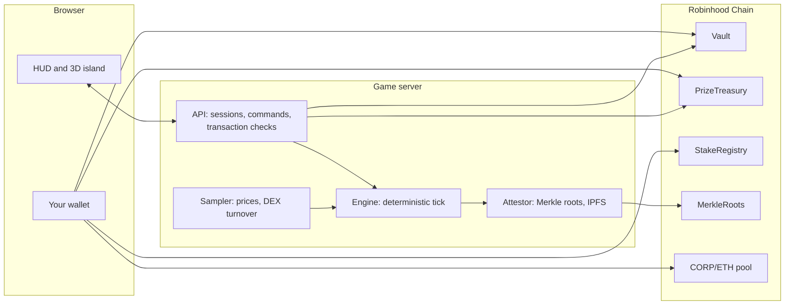

# Protocol and Contracts

Corporator is split between four small contracts and a game server. The contracts hold assets and enforce a few hard limits. The server runs the city simulation. This page shows which side enforces what, so you know what you're trusting.

## Architecture



| Component | Does | Doesn't |
|---|---|---|
| Browser | Draws the island and HUD, shows city state, asks your wallet to sign | Calculate payments or create Capital |
| API | Runs sessions and commands, prepares transactions for you to sign, checks them once signed | Trust a transaction hash from the browser. It reads the transaction from the chain and compares sender, target and data byte for byte. |
| Engine | Runs each tick as a pure function of recorded inputs, in whole-number arithmetic | Read the network, the clock or any random source during a tick |
| Sampler | Records `$CORP`, ETH and stock prices and DEX turnover as tick inputs | Make up a price when a source goes quiet. Stale inputs are marked stale. |
| Attestor | Publishes each city day's records as a Merkle root and an IPFS object | Change a payment. It runs after payment, and if it fails, payments continue. |
| Contracts | Hold `$CORP`, prize tokens, stakes and cooling unstakes. Cap minting. Pay withdrawals within coverage. Enforce the 30-city-day unstake cooldown. | Run schedules, Payroll, efficiency or any other game rule |

## On-chain and off-chain

| Action | Where it happens | Wallet signature | Who enforces the limits |
|---|---|:-:|---|
| Sign in | Off-chain session | Message only | Server |
| Deposit `$CORP` | `Vault.deposit` on-chain, then Capital on the server | Yes | Vault: amount received, mint ceiling. Server: mint rate. |
| Open and upgrade buildings, hire, research, tiers, merges | Server | No | Server |
| Payroll | Server, fund to city | No, automatic each tick | Server |
| Withdraw | Server takes the Capital and issues a voucher in the vault | No | Server: hours, limits. Vault: coverage. |
| Present a voucher | `Vault.presentVoucher`, `$CORP` to your wallet | Yes | Vault: matching fields, expiry, single use, coverage |
| Stake | `StakeRegistry.stake` from your wallet | Yes | Contract: custody. Server: opening, tiers. |
| Request an unstake | `StakeRegistry.requestUnstake`; tokens enter a 30-city-day cooldown | Yes | Contract: amount, cooldown. Server: grace period, freeze. |
| Collect an unstake | `StakeRegistry.claimUnstaked`, tokens to your wallet | Yes | Contract: the cooldown has ended |
| Buy a Stock Token | DEX route on-chain, tokens to your wallet | Yes | DEX. Server: quote freshness, that the tokens reached your wallet. |
| Claim Farm rewards | `PrizeTreasury.claimPrize` on the Farm pool, tokens to your wallet | Yes | Contract: amount owed. Server and prize signer: who is owed. |
| Claim a Monthly prize | `PrizeTreasury.claimPrize` on the Monthly pool, tokens to your wallet | Yes | Contract: amount owed. Server and prize signer: who is owed. |
| Publish records | IPFS and `MerkleRoots` on-chain | No | Attestor |

### Prepare, sign, confirm

Every command where your wallet moves an asset on-chain follows the same three steps: deposit, stake, unstake request, unstake collection, voucher presentation, Stock Token purchase, Farm claim and Monthly prize claim.

1. **Prepare.** The server returns the exact transactions to sign.
2. **Sign.** Your wallet sends them and pays the gas. Check the network, the contract address and the amounts before you approve.
3. **Confirm.** The server reads the transactions from the chain and compares them byte for byte with what it prepared. Only then does your city change.

If you signed but closed the tab, the server reads the outcome from the chain and brings your city up to date. Deadlines such as voucher expiry and the unstake cooldown follow block time, not the server's clock.

You don't sign the withdrawal itself: the server issues the voucher, and you sign only its presentation. See [Vouchers](economy.md#vouchers), [Unstaking](industries.md#unstaking-and-the-cooldown) and [Claims](seasons.md#claims).

The game server keeps no balance of your `$CORP` or Stock Tokens. They're either in your wallet or in one of the contracts below.

## Determinism and verification

A tick is a pure function of its recorded inputs: prices, turnover, player commands and the rules pack. Randomness comes only from `hash(city_id, tick_index, agent_id)`. Time comes only from city time. Nothing inside a tick calls the network, reads a wall clock or asks an AI model.

Within a tick, the engine works in this order:

1. Check the rules pack hash, and that entry is still cheaper than exit.
2. Update the mint rate from the recorded price.
3. Record DEX turnover and the trading-tax inflow.
4. At 00:00, close the Influence day.
5. At 06:00, refresh district efficiency and settle Farm windows and prize periods.
6. At 00:00, fix the next Payroll day budget.
7. Collect every seat's request, then pay.
8. Advance research, award XP, update City Level.
9. Apply spending, withdrawals, buybacks, the reserve release and the fund cap.

Each seat's result becomes a **decision record**: its inputs, efficiency, request, payment and idle reason. The record never includes your wallet address. It's serialised in one canonical, byte-exact form, and it's written after the payment.

| Check | What it proves | What you need |
|---|---|---|
| Replay | The calculation was right | The recorded inputs and the rules pack with the matching hash ([Versions](reference.md#versions)) |
| Merkle proof | A record belongs to the committed set | The record, its proof and the root |
| Chain lookup | The root was published | The `MerkleRoots` transaction you rely on |

Each check proves something different, and none replaces the others. The Journal marks a day **Verified** only when both its root and its IPFS object exist. The attestor can overwrite a day's root, so for a historical check, cite the publication transaction, not only the current value. A valid proof doesn't show that external prices were accurate or that the contracts are bug-free.

### For integrators

- **Reading state.** Vault and StakeRegistry emit events for vouchers and unstakes. PrizeTreasury and MerkleRoots emit none. Read everything else through the public view functions.
- **Records.** Each `(city_id, city_day)` has one Merkle root in `MerkleRoots` and one IPFS object with the records.
- **Rules.** Every result belongs to one rules pack, identified by version and hash.
- `[NEEDS CONFIRMATION]` A public game API for third parties isn't documented yet.

## Contracts

All four game contracts are written in Solidity 0.8.28. None has a pause function. None is deployed yet: addresses will appear in the [deployment register](#deployment-register).

### Vault

| | |
|---|---|
| Purpose | Holds all the `$CORP` that backs Capital. Records deposits, backing, withdrawal vouchers and refunds. |
| Network | Robinhood Chain (`4663`) |
| Address | Not deployed |
| Events | `VoucherIssued(nonce, account, corpAmount, issuedAtS)`, `VoucherPresented(nonce, account, corpAmount)`, `VoucherReleased(nonce)` |
| Controls | Deposit accounting, the 2,000 Capital-per-`$CORP` mint ceiling, voucher reservations and payouts, bounded refunds |
| Doesn't control | The mint rate, Bank hours, daily limits, Payroll |

| Function | Who can call | What it does |
|---|---|---|
| `deposit(account, corpAmount)` | `account` only | Pulls `$CORP` and credits the balance actually received as pending |
| `mintCapital(account, capitalAmount)` | Minter | Turns pending into backing. Refuses more than pending × 2,000. |
| `issueVoucher(nonce, account, corpAmount, issuedAtS)` | Voucher signer | Reserves `corpAmount` if the vault has free coverage. Each nonce works once. |
| `presentVoucher(nonce, account, corpAmount, issuedAtS)` | Anyone | Pays `account` if the fields match a live voucher. Draws on the account's backing first, then house backing. |
| `releaseExpiredVoucher(nonce)` | Anyone | Frees the reservation of an expired, unused voucher |
| `outcomeOf(nonce)` | View | `0` still open or unknown, `1` presented, `2` released after expiry |
| `refundPlayer`, `batchRefundPlayers` | Signer | Returns `$CORP` up to a player's unreserved backing |
| `setRefundRoot(root)` | Guardian | Sets a Merkle root for claimable refunds |
| `claimRefund(amount, proof)` | Claimant | One refund per address against the root, within available backing |
| `proposeSigner(next)`, `acceptSigner()` | Guardian, then the new signer | Two-step signer rotation |
| `recoverWrongToken(token)` | Guardian | Sends any token other than `$CORP` sent by mistake to the guardian |
| `voucherRoom`, `availableOf`, `backingOf`, `capitalOf` | View | Coverage and per-account balances |

Rules:

- The mint ceiling (2,000), voucher lifetime (3,750 s), minter, voucher signer, guardian and house address are fixed at deployment and can't change.
- Coverage can't be spent twice. An issued voucher reserves its amount, refunds can't touch reserved backing, presenting consumes the reservation, and expiry releases it.
- A voucher ends exactly one way, presented or released, and `outcomeOf` records which. The game returns Capital only for a released voucher.
- A refund is limited to recorded backing. It isn't insurance against market losses and doesn't return Capital you spent.

Example of a withdrawal by voucher:

```text
server → Vault.issueVoucher("n-123", player, 178253e18, t0)    // reserves coverage
player → Vault.presentVoucher("n-123", player, 178253e18, t0)  // before t0 + 3750 s
       ← 178,253 $CORP to player, outcomeOf("n-123") = 1
if unused after t0 + 3750 s:
anyone → Vault.releaseExpiredVoucher("n-123")                  // reservation freed, outcomeOf = 2
                                                               // the game returns the Capital
```

### PrizeTreasury

| | |
|---|---|
| Purpose | Holds the Stock Tokens bought for rewards in two separate pools, Farm and Monthly. Functions pick the pool with the `kettle` argument: `0` Farm, `1` Monthly. |
| Network | Robinhood Chain (`4663`) |
| Address | Not deployed |
| Events | None |
| Controls | Funding, per-wallet entitlements, claims |
| Doesn't control | Who qualifies or how much each wallet earns. The server calculates that, and the prize signer records it. |

| Function | Who can call | What it does |
|---|---|---|
| `deposit(token, kettle, amount)` | Depositor | Adds the amount received to that pool's unassigned balance |
| `slice(batchId, token, kettle, players, amounts)` | Prize signer | Assigns unassigned balance to wallets. Can't assign more than the pool holds. Each `batchId` works once. |
| `owed(kettle, token, account)`, `unsliced(kettle, token)` | View | A wallet's entitlement, a pool's unassigned balance |
| `claimPrize(token, kettle)` | Any wallet | Pays the caller its own entitlement and zeroes it |
| `returnUnsettled(token, kettle)` | Depositor | Takes back the unassigned remainder. Assigned entitlements stay. |
| `proposeSigner`, `acceptSigner` | Guardian, then the new signer | Signer rotation |
| `recoverWrongToken(token)` | Guardian | Recovers a token that isn't one of the six prize stocks |

Only the six configured prize stocks are accepted. The two pools never mix, and a claim pays only the caller.

### StakeRegistry

| | |
|---|---|
| Purpose | Holds staked Stock Tokens and tokens in the unstake cooldown, and reports both |
| Network | Robinhood Chain (`4663`) |
| Address | Not deployed |
| Events | `UnstakeRequested(account, ticker, amount, readyAtS)`, `UnstakeClaimed(account, ticker, amount)` |
| Controls | Custody of staked and cooling tokens, the unstake cooldown |
| Doesn't control | District opening, tiers, the grace period or the freeze. The server applies those from the snapshot. |

| Function | Who can call | What it does |
|---|---|---|
| `stake(account, ticker, amount)` | `account` only | Pulls tokens and credits the amount received |
| `requestUnstake(ticker, amount)` | The stake holder | Moves the amount from stake into the caller's cooldown for that ticker. Pays out an already-ready cooldown first. A still-cooling one is added to and restarts. |
| `claimUnstaked(ticker)` | The stake holder | Once the cooldown has ended, sends the cooling tokens to the caller |
| `snapshot(account)` | View | Lists tickers and active stake. Cooling tokens aren't included. |
| `coolingSnapshot(account)` | View | Lists tickers, cooling amounts and ready times |
| `unstakeCooldownS()` | View | The cooldown in seconds: 2,700,000, which is 30 city days |
| `setToken(ticker, token)` | Owner | Maps a ticker to its token address |

Rules:

- There's no instant unstake and no cancel. Every token leaves through the cooldown.
- The cooldown length is fixed at deployment and can't change.
- Only the account that staked can request, and collection pays only that account.
- The owner can change which token a ticker points to at any time.

### MerkleRoots

| | |
|---|---|
| Purpose | Publishes one Merkle root of decision records per `(city_id, city_day)` |
| Network | Robinhood Chain (`4663`) |
| Address | Not deployed |
| Events | None |

| Function | Who can call | What it does |
|---|---|---|
| `putRoot(cityId, cityDay, root)` | Attestor | Stores the root, or overwrites an existing one |
| `getRoot(cityId, cityDay)` | View | Returns the root. Reverts if there's none. |

### `$CORP`

`$CORP` launches through the pons V2 launch factory on Robinhood Chain, against ETH. It isn't one of the four contracts above.

| Fact | Value |
|---|---|
| pons V2 factory | `0x7ed598bcef8bd9edd8c97a195c6d13f40801ec7e` |
| Supply | 1,000,000,000 |
| Graduation | 4.2 ETH |
| Creator tax | 2% per trade |
| Snipe tax | Up to 99% on buys in the first 3 seconds after launch. The factory's owner can change this setting. |
| Token, curve and pool addresses | Not deployed |

`[NEEDS CONFIRMATION]` that the creator tax can't be changed after launch. We treat it as permanent, and that will be checked against the deployed token.

## Roles and permissions

| Role | Contract | Can | Can't |
|---|---|---|---|
| Minter | Vault | Mint Capital against pending deposits, up to ×2,000 | Mint without a deposit, or move `$CORP` |
| Voucher signer | Vault | Issue withdrawal vouchers within free coverage | Pay a voucher itself, or reuse a nonce |
| Signer | Vault | Refund players up to their unreserved backing | Touch reserved backing |
| Guardian | Vault, PrizeTreasury | Rotate the signer, set the refund root, recover stray tokens | Take `$CORP` from the vault or prize stocks from the treasury |
| House | Vault | Hold protocol backing that can cover vouchers | — |
| Prize depositor | PrizeTreasury | Fund both pools and take back unassigned balance | Take assigned entitlements |
| Prize signer | PrizeTreasury | Assign entitlements from funded balance | Assign more than is funded |
| Owner | StakeRegistry | Map tickers to tokens | Move staked or cooling tokens, or change the cooldown |
| Attestor | MerkleRoots | Publish and overwrite roots | — |

A role's name doesn't tell you whether one key, a multisig or a contract holds it. `[NEEDS CONFIRMATION]` The holder of each role will be published at deployment.

## Deployment register

This table is filled from real deployment records only. An empty field means the item doesn't exist yet.

| Item | Value |
|---|---|
| Network | Robinhood Chain |
| Chain ID | `4663` |
| Public RPC | `https://rpc.mainnet.chain.robinhood.com` |
| Block explorer | `[NEEDS CONFIRMATION]` |
| USDG | `0x5fc5360D0400a0Fd4f2af552ADD042D716F1d168` |
| `$CORP` token, curve and pool | Not deployed |
| Vault, PrizeTreasury, StakeRegistry, MerkleRoots | Not deployed |
| Stock Token address per ticker | `[NEEDS CONFIRMATION]` at deployment |
| Role holders | `[NEEDS CONFIRMATION]` at deployment |
| First period date | `[NEEDS CONFIRMATION]` at deployment |
| Source code and audit reports | `[NEEDS CONFIRMATION]` |
| Rules pack | See [Versions](reference.md#versions) |

## Risks

- **Market risk.** `$CORP` and Stock Tokens can lose value. Backing in `$CORP` isn't a fixed dollar amount.
- **Payment risk.** Payroll is finite and shared. Valid work can be paid less than it asked for, or nothing if the fund is empty.
- **Exit limits.** Bank hours, daily limits, the mint rate and vault coverage all restrict withdrawals. A Capital balance isn't a promise of full, immediate redemption.
- **Unstake cooldown.** Unstaked tokens are locked for 30 city days with no cancel, and you carry the token's price risk during that time.
- **Gas.** Presenting vouchers, staking, unstaking, collecting, buying and claiming are your own transactions, paid in ETH.
- **Exchange route.** Stock Token purchases run through an external route service. The game can't recover `$CORP` spent on a route that didn't deliver.
- **Custody and code.** Deposits, stakes and prizes sit in contracts. A bug, a compromised role or unusual token behaviour can affect them.
- **No pause.** The contracts can't be frozen, which removes one admin lever and also one way to respond to an incident.
- **Admin powers.** The roles above keep their permissions. The StakeRegistry owner can remap a ticker's token. The attestor can overwrite a root.
- **Third-party assets.** Stock Tokens and USDG are issued by others, under their own terms.
- **Launch.** Buying in the first seconds after launch can cost up to 99% in snipe tax.

Before you sign anything:

- Check the chain ID (`4663`) and the contract address against the deployment register.
- Use the game's deposit and stake flows. A plain token transfer to the vault or the registry doesn't credit your account.
- Before you request an unstake, check the ready date the HUD shows. If a cooldown is already running on that ticker, the HUD tells you it will restart.
- An approval only grants permission to spend. It doesn't prove a deposit happened, so check the spender and the amount.
- "Tested", "source verified" and "audited" mean different things, and none of them means a system can't fail.
