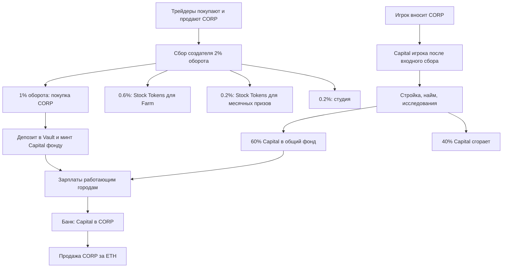

# Corporator: глубокий разбор текущей игровой экономики

Дата: 3 октября 2026. Проверенный контент: pack **209**, rules **0.24.0**, hash `1053fda2283e116cf4706ae3910b046f3a66594e8bf4bffc958e52a53b8d4bd8`.

**Мой вывод: идея подходит небольшому сообществу спекулянтов, но текущую реализацию нельзя считать готовой к денежному запуску.** Есть несколько воспроизведённых разрывов между игровым учётом и реальными активами. Даже после их устранения экономика не обеспечивает одинаковый или стабильный заработок всем: это соревнование за ограниченные сборы и перераспределяемые вложения, поверх риска цены $CORP.

Разбор исходит из 20–50 игроков на старте, 100 при сильном хайпе и 200 как верхнего рабочего сценария. Для 4,2 ETH принято допущение по модели репозитория: **ETH-сторона пула после graduation**, а не общий TVL и не казна игры. Механики и рабочий код не менялись. Новые расчёты и проверочные примеры сохранены только рядом с этим отчётом.

## 1. Что именно я проверил

Сопоставлены правила, параметры текущего пака, экономический движок, команды сервера, самплер, конвейер выкупа, Vault, StakeRegistry, призовая казна и экономический симулятор.

Выполнены **76 прогонов** существующей модели: 60 комбинаций числа игроков, оборота и длительности, плюс 16 стресс-сценариев. Повторно выполнены 165 существующих тестов экономического движка, контрактных адаптеров, buyback, sampler и attestor: 164 прошли, один упал на устаревшем ожидании номера пака 204 вместо текущего 209. Это не обнаруженный сбой распределения денег. Дополнительно прошли 8 специально составленных проверок текущего поведения. Они подтверждают обнаруженные проблемы; их зелёный результат не означает, что проблема исправлена. Foundry/EVM-тесты не выполнены: forge отсутствует.

Отдельно прошли **80/80** проверок команд API (research, build, hire, stake, merge, deposit, bank, recovery и отображение стоков). Всего существующих проверок в этом проходе: **244/245**, плюс 8/8 диагностических воспроизведений. Зелёные проверки отдельных операций не доказывают работоспособность всего денежного цикла.

Это анализ исходников и локального поведения. Полный цикл на реально задеплоенных контрактах с покупкой, начислением, ваучером и продажей не выполнялся. В `launch.deployed` текущего пака адреса запуска пусты; параметры Pons взяты из модели, а не из нового чтения фабрики в день запуска. Старые документы и `SIM.md` имеют другие версии пака и не заменяют проверку pack 209.

Доказательства: [результаты проверок](C:/Users/sk640/ai_city/docs/reports/economy-review-2026-10-03/probe-results.json), [все сценарии](C:/Users/sk640/ai_city/docs/reports/economy-review-2026-10-03/scenarios.json).

## 2. Пять сущностей, которые нельзя складывать как деньги

| Сущность | Что это | Как появляется | Как получить реальные деньги |
|---|---|---|---|
| ETH | Реальный актив котировки | Покупки трейдеров, сборы, собственные средства | Уже находится в кошельке или выводится из накопленных сборов |
| $CORP | Рыночный токен с фиксированным supply 1 млрд | Покупка на кривой/DEX, вывод из Vault | Продать на рынке по исполнимой цене |
| Capital | Непередаваемый внутренний баланс | Депозит $CORP, выплаты общего фонда | Обменять через банк на $CORP, затем продать |
| Stock Tokens | Внешние токены NVDA, TSLA, AMZN, AAPL, MSFT, COIN | Собственная покупка, Farm, месячные призы | Вывести/получить, затем продать; стейк сначала проходит cooldown |
| Fragments и Influence | Учёт требований на Farm и рейтинг | Валидная работа маяков; эффективность города | Сами не продаются; определяют долю реального призового пула |

Номинал **1 млн Capital = $1** — единица расчёта цен. У Capital нет долларового обеспечения по этому номиналу. Остаток Capital, построенные здания, накопленный Influence и ещё не обеспеченные требования на призы не равны выведенному доходу.

Общий путь денег:

Это **предполагаемый денежный цикл**. Найденные ниже проблемы мешают его реализации. Сгорает Capital, а обеспечивающие токены остаются в Vault: тратами зданий supply $CORP не сжигается.

## 3. Что означают стартовые 4,2 ETH

В модели после graduation в пуле примерно 4,2 ETH и **204,08 млн $CORP**, то есть 10/49 supply. На этой стартовой цене обе стороны вместе имеют оценку примерно **8,4 ETH**, но продать токеновую сторону за дополнительные 4,2 ETH без изменения цены нельзя.

Начальная предельная цена — **0,00000002058 ETH за $CORP**. По историческому ETH/USD $2500,87, который лежит в репозитории, это ~$0,00005147 и FDV ~$51 468. Это **снимок для арифметики, не текущий курс ETH**. Рабочий курс минта из него получается 51 Capital/$CORP. Потолок 2000 соответствует цене $0,002, примерно 39 стартовым ценам.

**4,2 ETH нельзя потратить на зарплаты как бюджет игры.** Это рыночная ликвидность, из которой оплачиваются продажи всех держателей. Общий фонд Capital в новом состоянии начинается с нуля. Его наполняют траты игроков, реально проведённые выкупы за сборы и ограниченный возврат резервов.

Модель предполагает запуск без покупки команды: её стартового запаса $CORP нет. Сборы на кривой могут дать отдельный стартовый бюджет. Например, при обороте 6,595× порога graduation, как в исторической фикстуре KOTS, 2% дают около **0,554 ETH**: примерно 0,277 ETH зарплатной ноге, 0,166 Farm, 0,055 месячным призам и 0,055 студии. Это пример при чужом коэффициенте оборота, а не обязательный доход любого запуска.

Pons описывает переход с кривой в Uniswap v4 и постоянную блокировку стартовой ликвидности. Блокировка позиции не фиксирует цену и количество ETH: продажи всё равно забирают ETH из пула. Сборы также нужно отдельно получить — они не отправляются получателю автоматически. [Документация Pons](https://docs.ponsfamily.com/v2).

Текущая документация Pons отличается от исторического снимка репозитория: например, окно snipe описано как 5 секунд, в модели — 3; базовая комиссия имеет собственное распределение. Перед запуском необходимо сверить именно выбранную фабрику и настройки создаваемой кривой. Здесь расчёты используют текущую модель Corporator: 2% creator tax плюс 1% площадки.

## 4. За что города получают зарплату

Здание не создаёт ETH и не печатает $CORP. Оно формирует **запрос на долю общего фонда Capital**. На выплату влияют роль агента, его уровень и черты, ресурсы, график, связи зданий, исследования и узлы районов.

В полночь фиксируется дневной бюджет:

`max(баланс фонда / 14, средний дневной приток за последние 3 дня)`.

За тик фонд выдаёт не больше минимального из трёх значений: запросы × разрешённый boost, бюджет тика, имеющийся баланс фонда. Потом эта сумма распределяется по весам запросов. Finance может увеличивать относительный вес города, в пределах установленного ограничения; дополнительные веса не добавляют денег фонду.

**×8 первые 7 суток города и ×3 затем — потолки, не ставки доходности.** Это общее окно запуска, а не семь персональных дней каждого нового игрока. Поздний участник не получает собственную новую неделю ×8.

Если город удвоил запрос, а остальные остались прежними, его доля может вырасти. Если все удвоили запросы при том же бюджете, общий доход не удваивается. Улучшения тогда усиливают конкуренцию за прежнюю сумму.

Траты возвращают 60% Capital в фонд и сжигают 40%. Реинвестирование помогает фонду жить дольше, но повторно распределяет уже существующую стоимость. Без торговых сборов или новых вложений оно не делает всех богаче. Резерв выдаёт не больше 5% доступного исходного резерва за неделю города при выполнении условий дефицита. Ограничение размера фонда по средним выплатам за 30 дней возвращает избыток в резерв; это не новый источник дохода.

Источники: [бюджет и выплаты](C:/Users/sk640/ai_city/packages/engine/src/economy.ts:367), [траты](C:/Users/sk640/ai_city/packages/engine/src/economy.ts:716).

## 5. Как устроена игровая петля

На одинаковом для всех острове **18 экономических зданий**. Игрок открывает их функции и уровни. Повторные экземпляры одного здания не строятся: нельзя сделать десять Workshop. Поэтому «расширение выгоднее глубины» означает переход к другим производителям и связям, а не копирование одной мастерской.

Capital производят только **Workshop, Robotics Lab, Flagship Store и Retail Complex**. Остальные дают Energy, Compute, логистику, доступ к операциям, слоты, веса выплат или связи. Розница зависит от Population и работает ограниченные часы. Robotics Lab сильнее Workshop по базовому запросу, требует обеих ресурсов. По правилам синергии должны связывать открытые районы; текущая команда постройки это условие для синергий не проверяет — см. находку J.

Роли: Engineer, Logistician, Trader, Scientist, Manager. Родная роль работает со 100% affinity, соседняя обычно с 60%. **Energy и Compute реально производит Engineer**. Scientist в вычислительном здании нужен для research/train и связей, но не заменяет производителя Compute. Поэтому интуитивный состав «учёный в AI Research Center, инженер в Robotics» может оставить роботизацию без Compute.

Неправильная роль, закрытые часы, стройка, выключение, заморозка района и отсутствие ресурсов останавливают соответствующую работу. При нехватке Compute уже списанная на этот шаг Energy возвращается. Ночь повышает Energy draw на 20%; Night Owl уменьшает надбавку до 8%. Overclock даёт +10% output за +45% Energy draw; он может ухудшить общий результат города с дефицитом энергии. Frugal снижает draw на 20% и output на 5%. Specialist даёт преимущество в родной роли и штраф вне неё. Steady сужает случайные колебания, а не гарантирует большую среднюю выплату.

Есть автономные места: Agent Hub работает в предусмотренном режиме без агента; пустой Robotics Lab может выдавать 60% базовой эффективности при выполнении остальных условий. Связи зданий требуют работоспособного источника; наличие модели на карте само по себе бонус не включает. Некоторые связи исключают друг друга и выбирают более сильную. Общий достижимый output stack около 12,46× — это запрос, не обещание такого же множителя денег.

Наём заданной роли и случайной роли сейчас стоит одинаково. Случайный пул содержит Engineer/Logistician/Trader, тогда как выбранная роль даёт нужного работника сразу. Для рационального игрока случайный наём почти не имеет экономического преимущества. Роли и черты вычисляются детерминированно; случайность не является скрытой лотереей с недоступным заранее результатом.

Population — формула `50 × занятые места + housing`, а не отдельная экономика тысяч NPC. Flagship Store даёт 400/900/2025 housing, Retail Complex — 600/1350/3037. Уровень города после достижения порога не снижается; можно сохранить разблокированные слоты после потери Population. Это допускает стратегии временного набора населения. Слоты агентов растут с 8 до 20 к уровню города 7. Happiness отображается, но денежный штраф в текущих правилах выключен.

Уровни агента растут через XP. Без дополнительных бонусов L2 требует 240 рабочих тиков, L3 суммарно 624, L4 1238, L5 2221: при 24 результативных тиках в сутки это примерно 10, 26, 51,6 и 92,5 суток города. L5 обычной работой не укладывается в 90-дневный сезон. У поддержки без собственного платёжного запроса XP от рабочих выплат также может не идти; обучение и XP-бонусы имеют отдельную ценность.

## 6. Сколько стоит старт и что означает окупаемость

| Позиция | Capital | Номинальный эквивалент |
|---|---:|---:|
| Workshop L1 | 34 217 877 | $34,22 |
| Power Node L1 | 11 291 899 | $11,29 |
| Agent Hub L1 | 17 108 938 | $17,11 |
| Первый агент | 5 132 681 | $5,13 |
| Второй агент | 5 748 603 | $5,75 |
| **Весь стартовый набор** | **73 499 998** | **$73,50** |
| Bank L1 дополнительно | 51 326 815 | $51,33 |
| Третий агент дополнительно | 6 438 435 | $6,44 |

Референс «депозит $150» в таблицах — 150 млн Capital до 2% Vault fee, затем 147 млн. Если игрок именно тратит $150 ETH на покупку $CORP, изначально нужны ещё торговая комиссия, влияние покупки на цену и округление курса.

Иллюстрация одного первого покупателя на стартовом CPMM: при историческом ETH/USD, покупке на $150, комиссии 3%, rate 51 и Vault fee 2% получается **около 139,36 млн Capital**, а не 147 млн. После стартового набора, Bank и третьего агента остаётся примерно **8,10 млн**. Это расчёт на фиксированных стартовых условиях; реальная сделка использует маршрут и рыночный курс на момент исполнения.

Workshop L1 с корректным Engineer и работающим Power Node link, без XP, черт и jitter, запрашивает около **148 990 Capital/тик**, то есть **3,576 млн за 24 тика**.

| Коэффициент фактической выплаты | Начисление за сутки города |
|---|---:|
| 50% | 1,788 млн Capital |
| 100% | 3,576 млн Capital |
| 300% | 10,727 млн Capital |
| 800% | 28,606 млн Capital |

Связь от Power Node действует в собственном графике; эта таблица предполагает 24 эффективных тика. При неизменной стартовой рыночной цене вариант 100% соответствует примерно **0,00127 ETH после банковской надбавки и комиссии продажи**, до влияния сделки на цену и газа, и только при доступном обеспечении и лимите банка. Это условная иллюстрация, не прогноз дохода.

Стартовый набор сам отправляет в общий фонд ~44,1 млн Capital. При делителе 14 это ~3,15 млн/сутки до прочих притоков — меньше указанного запроса Workshop. Сам стартовый набор не финансирует стабильную выплату ×8.

Апгрейды дорожают быстрее запроса: цена следующего уровня растёт 2,5×, базовый output 1,8×. Workshop L2 требует **ещё** 85,54 млн, L3 **ещё** 213,86 млн. Полная стоимость пути до L3 — 333,62 млн, а не 213,86 млн. Дополнительный базовый output L2 окупает свою дополнительную цену примерно за 750 тиков, L3 — за 1042 тика, без поправок на фонд, часы, ресурсы и бонусы. Поэтому улучшение уровня ради одного output — дорогой выбор; оно оправдывается также ресурсами, связями и ограничением доступных мест.

Табличная «окупаемость 13,29 суток» относится к определённой производственной нормировке. Она не доказывает возврат всего первоначального кошелькового вложения: там нет полной цены состава, Bank, стейка, всех простоев и рыночной продажи.

Источники: [текущие цены](C:/Users/sk640/ai_city/content/out/GENERATED.md:160), [команда апгрейда](C:/Users/sk640/ai_city/services/api/src/commit.ts:176).

## 7. Районы, исследования и блокировка средств

Открытие района требует фиксированного количества соответствующего Stock Token. Эти количества были выбраны примерно на **$100 за район по снимку 29 августа**, но в текущих долларах могут стоить иначе. Стейк не сгорает. Он остаётся отдельным активом игрока и несёт собственный рыночный риск.

Открытие T1 стоит 0 Capital, но само здание-маяк стоит 85,54 млн. T2 требует уровень города 3, стейк 2×S_min и 51,33 млн Capital; T3 — уровень 5, 3×S_min и 192,48 млн. По исходному снимку шесть районов означают около $600 стейка на T1 или $1800 на T3, **плюс развитие города**.

В каждом тире выбирается одна из двух веток. Рутинного бесплатного сброса выбора нет. Merge стоит 64,16 млн Capital, использует совместимые разные пары и ограничен тремя; это также постоянный выбор. Исследования стоят Capital, занимают 24–36 тиков и требуют работающего Scientist с Compute. Цена research должна включаться в окупаемость бонуса, а не считаться бесплатным множителем.

При unstake ниже порога район работает ещё 24 часа города (~25 реальных часов), затем замораживается; останавливаются маяк, зависимые синергии и узлы. Забрать снятые токены можно лишь после **30 суток города, то есть 31,25 реальных суток**. Новая заявка до созревания предыдущей перезапускает срок для всего незрелого объёма данного тикера.

Для человека, пришедшего на мемкоин на несколько дней, это сильное обязательство: месячная блокировка отдельного актива ради небольшой доли призов. Малое число участников улучшает долю, но не устраняет стоимость входа и ожидания.

## 8. Реальные источники и пределы заработка

У игрока четыре разных результата: зарплата в Capital; Farm в Stock Tokens; месячные призы в Stock Tokens; изменение рыночной цены удерживаемых активов. Последний результат может доминировать над всей игрой. Рост цены уже купленного $CORP нужно отдельно сравнивать с вариантом «просто держать тот же токен».

По распределению текущего пака:

| Оборот за условный месяц | Зарплатная нога 1% | Farm 0,6% | Месячный пул 0,2% | Студия 0,2% |
|---|---:|---:|---:|---:|
| $5 000 | $50 | $30 | $10 | $10 |
| $20 000 | $200 | $120 | $40 | $40 |
| $50 000 | $500 | $300 | $100 | $100 |
| $300 000 | $3 000 | $1 800 | $600 | $600 |

Оборот — сумма покупок и продаж, **не чистый приток**. Эти суммы — распределённый валовой сбор до выкупов, комиссий маршрутов, газа, изменения цены купленных активов и невыплаченных остатков. Зарплатная нога сначала покупает $CORP; её долларовая оценка не равна фиксированной долларовой выплате.

При 50 игроках и обороте $50 000 средняя внешняя зарплатная нога — всего **$10 на игрока за месяц**, примерно $0,33/день, до потерь и неравного распределения. При 20 игроках это $25/месяц, при 100 — $5, при 200 — $2,50. Более крупные видимые начисления могут поступать из расходования стартовых вложений и резервов.

В Farm доля зависит от накопленных фрагментов в конкретном тикере. Фрагменты выдаются за валидную работу маяка до расчёта Payroll; низкая зарплатная доля их напрямую не уменьшает. Но фрагменты не создают токены: получить можно только долю реально наполненного пула. При двух и более городах действует кап 50% на город; единственный участник может получить весь пул. Шесть тикеров — отдельные кассы: отсутствие участника или денег в одной не превращает её бюджет в другой актив.

Если $300 Farm при обороте $50 000 условно делят 50 одинаковых участников, это ~$6 каждому за месяц. Если Farm занимается только 10 сравнимых игроков — ~$30. Реальное распределение зависит от тикеров, участия, модификаторов и капов. Для шести стейков первый вариант очень слаб; для одного подходящего района при малой конкуренции второй может быть интереснее.

В месячных призах квалификация требует **6 положительных дней из 30 и живой стейк района**. Один кошелёк занимает один слот своим лучшим квалифицированным городом. Платят топ-10. При десяти участниках доли по рангу примерно 32,25%; 16,52%; 11,27%; 8,65%; 7,08%; 6,02%; 5,28%; 4,72%; 4,28%; 3,93%, до дополнительного ограничения по рабочему вкладу.

| Месячный оборот | Пул | Номинальная доля #1 | Номинальная доля #10 |
|---|---:|---:|---:|
| $5 000 | $10 | $3,23 | $0,39 |
| $20 000 | $40 | $12,90 | $1,57 |
| $50 000 | $100 | $32,25 | $3,93 |
| $300 000 | $600 | $193,50 | $23,58 |

При меньшем количестве квалифицированных кошельков доли пересчитываются; при одном он получает весь доступный пул. Никто не квалифицировался — пул переносится. На низком обороте газ и шаги получения шести активов могут оказаться существеннее небольшого приза; фактические расходы в этой оценке не измерены.

Influence вознаграждает GDP относительно вложенного Capital, стабильность рабочих тиков, эффективность и покрытие работающих районов. Поэтому не всякое дорогое улучшение улучшает ранг. Покупка поддержки без достаточного прироста GDP ухудшает интенсивность; открытие района без работы ухудшает coverage. Маленький продуманный город может обогнать неэффективный большой. Однако оптимизированный кит и несколько кошельков сохраняют преимущества: «один кошелёк — один слот» не исключает Sybil.

У студии тоже мало денег: $100 валового дохода при месячном обороте $50 000. Игровые траты не дают ей отдельного процента. Серверы, операции и сервисный газ должны помещаться в этот доход либо иметь отдельное финансирование. Доход будущих NFT и других неработающих функций в устойчивость текущего цикла не включён.

**Коллективный денежный плюс не появляется из самого производства.** Например, 50 игроков по $150 — $7500 входа. Только дополнительная прибыль 10% всем вместе означает $750. Если считать источником все 1,8% оборота, направляемые игрокам, нужна нижняя граница ~$41 667 оборота; по зарплатной ноге 1% — $75 000. Это ещё без входных потерь, строительства, газа и неполного распределения. При этом активные/ранние участники могут оказаться в плюсе, а другие — в минусе.

## 9. Комиссии и банковский выход

У обычного круга «покупка → Vault → Bank → продажа» при неизменной цене фиксированная потеря примерно:

`1 − 0,97 × 0,98 / 1,10 × 0,97 = 16,17%`.

Таблица 14,45% в текущей документации учитывает только 2% creator tax на торговых сторонах, пропуская дополнительный 1% площадки. С теоретической банковской надбавкой Trader 6,5% полный круг был бы около **13,42%**; обычная команда вывода сейчас эту скидку не применяет. В обеих оценках ещё нет price impact и газа. Это потери без производства и без изменения цены, а не обязательный итог активного игрока.

Банк работает 08:00–20:00 города и закрыт по городским воскресеньям. Сутки города длятся 25 реальных часов; расписание ежедневно смещается относительно местного времени. Один незакрытый ваучер блокирует новый вывод данного города, срок предъявления — 3750 секунд. Выдача ваучера и фактическое получение/продажа — отдельные этапы.

По замыслу общий дневной предел — **5% актуального ETH-резерва**, на сиде 0,21 ETH. У L1 персональный максимум 25% общей пропускной способности, то есть 0,0525 ETH; рост Finance Tower поднимает долю, но не общий бюджет.

| Игроков | Условный равный раздел общего предела 0,21 ETH |
|---:|---:|
| 20 | 0,0105 ETH/сутки города |
| 50 | 0,0042 ETH |
| 100 | 0,0021 ETH |
| 200 | 0,00105 ETH |

Это **не доход и не гарантированная очередь**. Текущий API выделяет лимит последовательно поступившим заявкам. Четыре L1-города могут занять его целиком до остальных. Симулятор распределяет одновременные запросы пропорционально, поэтому его справедливость не совпадает с сервером. Несколько кошельков/городов также могут обходить смысл персональных долей.

Предел регулирует получение новых $CORP из игры, но не продажи уже лежащих в кошельке токенов. Внешние держатели вообще не обязаны пользоваться Bank. LP lock и банковские часы не защищают от их выхода.

При падении настоящего резерва до 2,1 ETH правильный общий предел должен уменьшиться до 0,105 ETH. Сейчас сервер **не синхронизирует живую глубину пула** для этой формулы; это отдельная обнаруженная проблема.

## 10. Что тонкий пул делает с продажами

На стартовой модели постоянного произведения с ETH-резервом Q=4,2 продажа токенов, оценённых по цене до сделки в S ETH, получает `Q × S / (Q+S)`. Отношение новой цены к старой — `(Q/(Q+S))²`.

| Номинал продажи по цене до сделки | ETH получено до сборов | Потеря средней цены исполнения | Падение цены после сделки |
|---:|---:|---:|---:|
| 0,1 ETH | 0,09767 | 2,33% | 4,60% |
| 0,5 ETH | 0,44681 | 10,64% | 20,14% |
| 1 ETH | 0,80769 | 19,23% | 34,76% |
| 2 ETH | 1,35484 | 32,26% | 54,11% |

Это ориентир по модели стартовой позиции, а не котировка произвольного будущего v4-пула с добавленной ликвидностью. Он показывает масштаб: выход даже небольшой группы может сильно снизить цену. Кроме того, месячный оборот $50 000 вполне возможен при тонкой ликвидности через повторные сделки — он не означает, что кто-то внёс в резерв $50 000 свежих денег.

Выкуп на 1% оборота поддерживает спрос, но не гарантирует компенсацию всех выходов. Ограничение транша выкупа 0,33% глубины и минимальная партия 0,008 ETH помогают ограничивать затраты и воздействие сделки. При историческом ETH/USD минимум партии ~$20; если зарплатная нога получает лишь $50/месяц, даже корректный конвейер копит такую партию примерно 12 дней. На низком обороте ежедневного внешнего пополнения может не быть.

Самоторговля ради наград не является источником коллективного дохода: оборот обходится примерно в 3% на каждую сделку, а игрокам предназначены всего 1,8% его суммы. Часть участник может перехватить у других через долю фонда или рейтинг, но убытки на комиссиях и рынке никуда не исчезают.

## 11. Результаты сценариев для 20–200 игроков

Существующая модель использована как диагностический инструмент, а не прогноз реальных кошельков. Для сравнения взяты её стандартные когорты minimalist/optimizer с одинаковым reference input, в пропорции 50/50. Она считает упрощённые города и замороженную исходную котировку. Месячный оборот задаёт темп поступления; 90 суток города — 93,75 реальных суток.

Ниже — процент стандартного производственного запроса, оплачиваемый **к концу 90 суток города**:

| Игроков | Оборот $0/мес. | $5 000 | $20 000 | $50 000 | $300 000 |
|---:|---:|---:|---:|---:|---:|
| 20 | 4,00% | 6,83% | 21,84% | 52,40% | 136,13% |
| 50 | 4,64% | 6,04% | 13,37% | 22,56% | 79,37% |
| 100 | 4,24% | 9,12% | 11,71% | 21,60% | 57,71% |
| 200 | 4,11% | 5,70% | 9,81% | 18,44% | 47,71% |

Это доля выплаты в условной модели, **не процент доходности депозита**. Немонотонность отдельных ячеек связана с накоплением/порогами выкупов, выходами и изменением модельного пула; их не стоит интерпретировать как точные рыночные закономерности.

К 7-м суткам при нулевом заданном внешнем обороте модель всё ещё платит около 74–75% базового запроса; к 90-м — около 4–5%. Хорошее впечатление первой недели возможно даже без устойчивого внешнего заработка, поскольку модель расходует вложения и резервы.

При $50 000/месяц модельный ETH-резерв к концу 90 суток составляет примерно 4,08 ETH при 20 игроках; 3,53 при 50; 2,90 при 100; 2,16 при 200. При нулевом обороте — 3,74; 3,22; 2,60; 1,89 соответственно. Это не прогноз настоящей цены: покупки входящих игроков в исходной модели не проходят через реальный пул, а котировка остаётся замороженной.

При падении оборота в 10 раз с 15-го дня, начиная с $50 000/месяц, конечная доля оплаты падает примерно до **6–8%**. В модели массового выхода число срезанных банковских заявок растёт с 0 при 20 игроках до 4 при 50, 78 при 100 и 216 при 200. Нельзя переносить эти числа на реальную очередь API, но направление очевидно: общий выход усиливает ограничения и ценовое давление.

### Почему прежние показатели «возврата» нельзя читать как прибыль

В [симуляторе](C:/Users/sk640/ai_city/content/sim.py:337) `returns_bank` — это **Capital, списанный при выводах, / исходный reference input**. Он не считает чистый ETH после фактической продажи. Показатель больше 100% не доказывает, что кошелёк окупился.

Другие ограничения модели:

- Начальный депозит целиком считается потраченным на готовый условный город; реальные последовательные открытия, роли, стройка и ресурсы не разыгрываются.
- У города одна сводная производительность и `energy_ok=1`; production нельзя считать проверкой конкретного игрового билда.
- Стартовые research-бонусы архетипа применяются без полного пути покупки и выполнения исследования.
- Реинвестирование списывает Capital, но не строит реальные улучшения, которые меняли бы production.
- Когорты с весом N не моделируют N независимых банковских заявок и их очередность.
- Входные покупки не расходуют/пополняют реальный seed pool; цена в стандартной серии не следует за всеми изменениями его резервов.
- Записанная стоимость банковского выхода не равна фактически проданному ETH, особенно когда архетип удерживает часть $CORP.
- Сценарий `spend_stop` прекращает в той же ветке и выводы, поэтому не является чистой проверкой «перестали строить, но продолжили забирать доход».

Для честной окупаемости нужны фактический внешний расход, полученные ETH, удержанные ликвидные активы по исполнимой цене, стоимость стейка и газа. Возврат собственного первоначального Stock Token после cooldown — возврат капитала, а не призовая прибыль. Выручку от продажи и стоимость того же уже проданного актива нельзя считать дважды.

## 12. Обнаруженные проблемы текущей реализации

### A. Зарплатный выкуп не доводит сборы до реального фонда — критично

В обычном collector `withFund` расчёт размера покупки получает глубину **0**, поэтому покупка $CORP не вызывается. В отдельной проверке все 12 вызовов покупки были Stock Tokens, ни один — CORP. Если искусственно передать успешный `fundCorpOut`, конвейер делает депозит в Vault, но **не вызывает mintCapital**: токены остаются pending, scheduler читает уже оформленный backing. Вспомогательная `depositThenMint` есть, но в рабочем пути не вызывается.

Дополнительно ранняя ветка без Farm demand возвращает idle без `withFund`, связывая зарплатную ногу с наличием фрагментного спроса. API не передаёт живую CORP depth, а stock depth заполняет фиксированным тестовым значением. Полного получения накопленных Pons fees перед расходованием расчётного бюджета в исследованном конвейере не найдено.

В live scheduler математическое начисление внешнего оборота движку специально отключается; денежный приток должен проходить через подтверждённый house backing. Поэтому нельзя считать, что симуляторная покупка внутри движка закрывает отсутствующую настоящую операцию.

Доказательства: [collector](C:/Users/sk640/ai_city/services/buyback/src/collect.ts:275), [deposit без mint](C:/Users/sk640/ai_city/services/buyback/src/conveyor.ts:269), [live scheduler](C:/Users/sk640/ai_city/services/api/src/scheduler.ts:169), [построение кадра](C:/Users/sk640/ai_city/services/api/src/buyback_frame.ts:203).

### B. Общий игровой фонд не соответствует доступному обеспечению получателей — критично

Игрок B внёс 10 000 CORP и потратил весь Capital. В игровом учёте образовался общий фонд **299 880 Capital**; баланс B стал нулём. В контрактном учёте весь backing B всё ещё принадлежит B. У A есть собственные 100 CORP обеспечения. Выдача A ваучера на 101 CORP отклоняется, хотя Vault содержит 10 100 CORP. Ваучер на 100 разрешён.

Контракт защищает backing остальных аккаунтов и позволяет расходовать собственный, house или действительно свободный баланс. Траты и выплаты Capital не переносят backing между этими категориями. Получить зарплату в общем учёте поэтому не значит иметь достаточно своего/доступного контрактного обеспечения для её вывода.

Пример выполнен с настоящей функцией engine spend и контрактоподобным chainport mock; соответствующие ограничения прочитаны в Solidity. Сам байткод в EVM здесь не исполнялся. [Vault.voucherRoom](C:/Users/sk640/ai_city/contracts/src/Vault.sol:141), [engine spend](C:/Users/sk640/ai_city/packages/engine/src/economy.ts:716).

### C. Пересоздание API повторно начисляет старый house backing — критично

`houseBackingSeen` хранится в памяти WeakMap, а не в восстановленной базе или курсоре депозитов. При новом экземпляре host сохранённое игровое состояние остаётся, а already-seen становится нулём. Проверка: после первого учёта фонд **49 980 000**, после пересоздания host при неизменном физическом backing — **99 960 000**. Внутренний vault balance тоже увеличивается математически, поэтому локальный инвариант не обязан обнаружить повтор.

Обратная проблема: если house backing уменьшился после выплаты, следующий новый депозит может не начисляться, пока баланс не превысит старый максимум. Нужен учёт событий/операций с устойчивой идентичностью, а не разности баланс–исторический максимум в памяти. [scheduler](C:/Users/sk640/ai_city/services/api/src/scheduler.ts:17).

### D. Оракул не соответствует маршруту Uniswap v4 — критично

При режиме v4 чтение цены жёстко предполагает CORP как currency0. Для пары с native ETH currency0 — ETH, поэтому нужно обратное отношение. Порядок валют не читается. Для оборота этот же путь запрашивает **V2 Swap event** по pool address; v4 Swap имеет другую сигнатуру и PoolId в PoolManager. Отсюда неверная цена/нулевой или неверный оборот на целевом маршруте.

В тесте старый положительный Chainlink round с `updatedAt=1` принят без проверки возраста. Свежий момент локального опроса не делает исходную котировку свежей. Режима чтения bonding curve до graduation также нет в этом sampler path; обещание принимать депозиты до появления пула требует отдельного работающего источника.

Кроме того, sampler опрашивает каждые 50 секунд, читает оборот последней минуты, а API выбирает один latest sample за час города, вместо накопления всех сделок с курсором. Даже после исправления сигнатуры это не полный объём за 3750 секунд: при равномерном потоке одна минута — около 1,6% такого интервала. При повторении старого sample возможен противоположный эффект повторного учёта. Это вывод из трассировки источников, отдельный end-to-end тест интервалов не выполнялся.

Доказательства: [sampler](C:/Users/sk640/ai_city/services/sampler/src/chain.ts:115), [публикация минутного оборота](C:/Users/sk640/ai_city/services/sampler/src/loop.ts:48), [выбор latest](C:/Users/sk640/ai_city/services/api/src/scheduler.ts:100). Формат и порядок подтверждены [Uniswap IPoolManager](https://github.com/Uniswap/v4-core/blob/main/src/interfaces/IPoolManager.sol) и [PoolKey](https://github.com/Uniswap/v4-core/blob/main/src/types/PoolKey.sol).

### E. Курс минта ниже 50 не может восстановиться — критично

Повышение считается в целых Capital/CORP: `floor(rate × 1,02)`. При rate 43–49 результат равен исходному значению. После падения с seed 51 или деградации по stale курс может застрять. Проверка **43 → цель 510 → 365 дней → всё ещё 43**. Rate 49 также не растёт. [applyRatchet](C:/Users/sk640/ai_city/packages/engine/src/arith.ts:21).

Есть отдельный риск самой модели плавающего курса: уменьшение mint rate одновременно уменьшает цену обратного обмена старого Capital в токены. Пример без Vault fee: 100 CORP дали 5100 Capital при rate 51; если rate стал 43, обратный обмен всей суммы требует ~107,82 CORP после надбавки 10%. Входной сбор уменьшает сумму, но не устраняет риск более сильного снижения курса. Верхний инвариант `Capital ≤ CORP × 2000` не гарантирует покрытие такого выхода по текущему rate.

Подъём цены создаёт другое распределение: рынок может уйти вверх быстро, а курс минта поднимается медленно. Новые игроки получают меньше Capital за потраченные ETH, ранние могут извлекать больше рыночной стоимости из старого Capital. Это нужно моделировать отдельно от сценария фиксированной котировки.

### F. «5% живой глубины» пока используется с модельными резервами — высокое влияние

Bank считает cap от `state.pool_eth`; реальные резервы Pons/v4 не загружаются в state этим самплером. Серверная модель обновляется в математических buy/sell путях, а не от всех внешних сделок. Поэтому ограничение может остаться основанным на seed или виртуальных изменениях после существенного движения настоящего рынка. [quoteWithdraw](C:/Users/sk640/ai_city/services/api/src/commit_bank.ts:349).

### G. Bank building и Trader не соответствуют ожидаемому смыслу — высокое влияние

Проверка вывода проходит без построенного Bank. `applyCityScope` назначает baseline bank level 1, а проверка команды не требует активного Bank. Override Trader 650 не меняет результат: API использует фиксированный markup 1000. Документация уже частично признаёт неработающую скидку, но в других таблицах она продолжает фигурировать как доступный эффект. [quoteWithdraw](C:/Users/sk640/ai_city/services/api/src/commit_bank.ts:319), [фиксированная надбавка](C:/Users/sk640/ai_city/services/api/src/commit_bank.ts:285).

Это не означает, что все функции Trader бесполезны: роль участвует в рознице, районах и связях. Именно банковская скидка не проведена в команду вывода.

### H. Offline cap в живом городе не совпадает с симуляцией — влияние на баланс

Путь настоящих buildings/agents переходит в `collectSlotRequests` до проверки индивидуального offline window. При регулярной работе сервера город продолжает работать независимо от времени последнего входа. Проверка на 108-м тике: реальная Workshop выдаёт запрос **135 445**, упрощённый город в запрещённой фазе `login_period=24` — **0**. Лимит catch-up при остановке сервера существует, но это другое условие.

Следовательно, разница доходности minimalist/optimizer через расписание входов и продажа полезности дополнительных offline hours не доказаны для обычных живых городов. [collectRequests](C:/Users/sk640/ai_city/packages/engine/src/economy.ts:547).

### I. Экономические таблицы вводят в заблуждение — влияние на решения

Полный круг занижен до 14,45%; банковский «возврат» в модели означает сожжённый Capital, не ETH; упрощённые города не соответствуют реальным затратам и очередям. Из-за этого нельзя публиковать нынешние simulation returns как обещание окупаемости. Исправление отчётной модели обязательно перед выбором новых чисел баланса.

### J. Синергии и найм не требуют заявленных открытий — влияние на баланс

Новая проверка текущего API: у города только City Hall, нет ни открытых районов, ни Stock Token stake. Команда hire успешно нанимает Engineer без Agent Hub; команда build успешно открывает Robotics Lab без Compute и Energy. После завершения строительства автономный Robotics Lab выдаёт запрос **325 069 Capital/тик**, если дать ему достаточно ресурсов. Наличие ресурсов в этой проверке задано отдельно, чтобы изолировать проверку доступа; это не доказательство полностью оплаченного маршрута роботизации без стейка.

Причина: `placementDistrictLocked` сразу пропускает здания без собственного district, включая синергии; `buildingDistrictFrozen` проверяет только уже записанную заморозку, а не факт открытия требуемых районов. `applyHire` проверяет Capital и свободные слоты, но не Agent Hub. Источники: [проверка строительства](C:/Users/sk640/ai_city/services/api/src/commit.ts:128), [заморозка](C:/Users/sk640/ai_city/packages/engine/src/slots.ts:61), [найм](C:/Users/sk640/ai_city/services/api/src/commit_agents.ts:90).

Экономический смысл: заявленную стоимость доступа к синергиям через два стейка нельзя считать реально обеспеченным барьером. Для найма необходимо отдельно решить, является ли Agent Hub обязательным условием или лишь зданием поддержки. В текущей версии его нельзя называть обязательной расходной частью минимального старта только потому, что он включён в референсный набор. Публичный интерфейс может скрывать некоторые действия, но серверное правило должно быть согласовано с описанием.

### K. Рыночная эффективность районов ещё не подключена к живому источнику

Движок уже принимает `district_quotes`, строит EMA и умножает выход районных производителей на efficiency; синергия использует среднее двух районов, обычный Workshop остаётся нейтральным. Это подтверждают прошедшие проверки `weather.test.ts`. Но текущий sampler публикует только ETH/USD, CORP/ETH и оборот, а scheduler не передаёт `district_quotes`. Поиск этого поля в рабочем коде серверов не нашёл поставщика. Поэтому нельзя считать влияние цен NVDA/TSLA и остальных стоков работающей живой механикой: без котировок эффективность остаётся нейтральной либо со временем возвращается к ней.

Это также расхождение с нынешней публичной страницей industries, которая говорит, что seat requests всегда используют 100%: код уже умеет другое, но реальные данные ещё не проведены. Источники: [приём district quotes](C:/Users/sk640/ai_city/packages/engine/src/tick.ts:170), [применение погоды](C:/Users/sk640/ai_city/packages/engine/src/slots.ts:46), [публикация sampler](C:/Users/sk640/ai_city/services/sampler/src/loop.ts:68), [входы scheduler](C:/Users/sk640/ai_city/services/api/src/scheduler.ts:116).

## 13. Ожидаемые сценарии поведения людей

**20–50 участников, активная первая неделя.** Вложения и разовые сборы запуска дают хорошее видимое начало. Игроки открывают Workshop, ищут выгодные связи и один доступный район. Соревнование ощущается; общий банковский выход относительно просторнее. Риск — принять стартовый расход вложений за устойчивую ставку дохода и завысить ожидания.

**50 участников, $5–20 тыс. месячного оборота.** Внешние зарплаты ~$1–4/месяц на игрока в среднем до потерь. Farm общий ~$30–120. Рост без новых депозитов замедляется; дорогие улучшения начинают проигрывать выводу и сохранению ликвидности. Это может быть игра ради рейтинга и участия, но слабый продукт ради денежных выплат.

**50 участников, $50 тыс. оборота.** Умеренно жизнеспособный небольшой конкурс: ~$500 зарплатной ноге, ~$300 Farm, ~$100 месячным призам. Сильные участники могут забрать ощутимую долю, особенно когда в конкретном районе мало конкурентов. Всем окупиться только от этих сборов за месяц трудно.

**100–200 участников с тем же оборотом.** Депозиты дают больше начального фонда, но новые участники делят прежнюю внешнюю выручку, конкурируют за общий банковский предел и сильнее давят продажами на пул. Рост онлайна без пропорционального оборота ухудшает внешние выплаты на человека. Начальная потребность в пополнении при этом может временно расти сама через покупки $CORP.

**Хайп и быстрый рост цены.** Появляется крупный спекулятивный результат, оборот и выкупы; ранний Capital может стать выгодным относительно входа поздних участников. Поздний игрок видит хорошие чужие результаты, но платит дороже при медленном mint rate. Если в это время он ещё блокирует Stock Tokens на месяц, он берёт второй риск вдобавок к $CORP.

**Хайп исчез через несколько дней.** Сборы сокращаются, фонд некоторое время сглаживает зарплаты; затем падает payout ratio. При стабильном запросе срок улучшений удлиняется. Более низкая цена может одновременно снизить ликвидность продажи и увеличить токены, которые требуют старые Capital-балансы. Это самый важный сценарий для целевого рынка.

**Оптимизаторы с несколькими кошельками.** Могут претендовать на больше персональных банковских долей, отдельные призовые слоты и Farm-доли. Защита накладывает затраты и время, но не исключает стратегию. Предсказуемая очередность и tie-break по ID дают преимущество ранним/автоматизированным участникам.

**Никто больше не строит.** Канал 60% трат пропадает; остаются сборы и ограниченный резерв. Ни код возврата в фонд, ни новые множители output не создают внешний доход. Здесь решается, интересна ли сама оптимизация города без быстрой денежной окупаемости.

## 14. Оценка и порядок дальнейшей работы

| Что оцениваю | Оценка | Основание |
|---|---:|---|
| Игровая идея | **7/10** | Связи, ресурсы, разные цели, ограниченные выплаты и внешние активы дают стратегические решения небольшой группе |
| Экономическое соответствие аудитории | **5/10** | Можно конкурировать за сборы, но стоимость входа, месяц стейка и медленный прогресс тяжёлы для короткого внимания мемкоин-рынка |
| Готовность денежного цикла | **3/10** | Несколько подтверждённых разрывов buyback/backing/oracle/recovery; полный кошельковый цикл не проверен |

Это субъективные оценки по перечисленным основаниям, а не вероятность успеха или оценка безопасности контрактов формальным аудитом.

**Первый приоритет — сделать денежный цикл согласованным.** Получение fees, подтверждённая покупка, deposit+mint, перенос доступного обеспечения, устойчивые курсоры операций, правильная v4/curve цена и оборот, живая глубина, восстановление rate после падения. Должно быть доказано, что заработанное в игре реально можно получить, и одна операция не начисляется повторно после рестарта.

**Второй — честная модель кошелька.** Покупать входные токены по настоящей кривой/пулу, исполнять реальный билд и исследования, учитывать очередность Bank и фактический ETH продаж. Отдельно показывать возврат тела вложения, прибыль от игры, рыночное изменение удерживаемых активов, заблокированные средства и газ. Сравнивать с простым удержанием того же $CORP.

**Третий — баланс именно для 20/50/100/200 человек.** Учитывать обороты $5/20/50 тыс., всплеск первых 2–3 дней и последующий провал. Не считать $300 тыс. обязательной нормой. Состав должен быть способен дать понятный первый результат за несколько дней; выгода очередного улучшения должна объясняться приростом доли, ресурса или доступом к призам.

**Четвёртый — выбрать обещание игроку.** Для этой аудитории сильнее выглядит небольшой конкурентный город с понятными шансами забрать часть сборов и Stock Tokens, чем обещание стабильной доходности. Малый онлайн сам по себе не провал: 20 увлечённых участников с оборотом могут быть здоровее 200 случайных. Но красивый Capital-баланс без объяснимого выхода быстро подрывает доверие.

Я бы не начинал с повышения boost или налогов. Пока реальный путь денег не закрыт и ROI неправильно измеряется, новые параметры лишь делают таблицы привлекательнее, не доказывая работоспособности экономики.

## 15. Файлы для воспроизведения

- [scenarios.py](C:/Users/sk640/ai_city/docs/reports/economy-review-2026-10-03/scenarios.py): дополнительные серии на текущем pack 209; исходные pack/SIM не перезаписывает.
- [scenarios.json](C:/Users/sk640/ai_city/docs/reports/economy-review-2026-10-03/scenarios.json): все 76 результатов, поля с явным различием Capital и ETH.
- [probes.ts](C:/Users/sk640/ai_city/docs/reports/economy-review-2026-10-03/probes.ts): восемь проверок текущего поведения; это характеристика обнаруженных проблем.
- [probe-results.json](C:/Users/sk640/ai_city/docs/reports/economy-review-2026-10-03/probe-results.json): численные доказательства.

- [test-results.json](C:/Users/sk640/ai_city/docs/reports/economy-review-2026-10-03/test-results.json): свежий прогон 41 существующего тестового файла, 165 проверок, 164 успешны. Единственное падение — ожидаемый номер версии пака, 204 вместо 209, в buyback B1.
- [api-test-results.json](C:/Users/sk640/ai_city/docs/reports/economy-review-2026-10-03/api-test-results.json): 80/80 успешных проверок команд сервера в четырёх существующих файлах.
- [cash-scenarios.json](C:/Users/sk640/ai_city/docs/reports/economy-review-2026-10-03/cash-scenarios.json): бюджеты сборов, последовательные покупки при растущем пуле и влияние продаж.
- [cash_scenarios.py](C:/Users/sk640/ai_city/docs/reports/economy-review-2026-10-03/cash_scenarios.py): воспроизведение дополнительной арифметики. Значения курса ETH взяты из исторического снимка пака, а не из сегодняшней рыночной цены.

## 16. Почему растущий пул не закрывает проблему входа

Покупки увеличивают ETH-сторону пула. Уточнение владельца верно: 4,2 ETH не являются вечным фиксированным резервом. Однако продажи его уменьшают, и важен **чистый поток покупок и продаж**, тогда как сборы зависят от их **суммарного оборота**. Эти два показателя нельзя заменять друг другом.

Дополнительная иллюстрация: после graduation люди последовательно покупают CORP на $150 и вносят его в игру в пределах одного дня. ETH/USD взят из старого снимка $2500,87; курс минта остаётся стартовым 51, входная комиссия 2%, торговая 3%. Нет встречных продаж, выкупов или новых LP-позиций. Это модель чувствительности CPMM, а не точная котировка произвольного v4-пула.

| Номер покупки | ETH-резерв после неё | Цена относительно старта | Capital этого покупателя | Референсный набор 73,5 млн доступен |
|---:|---:|---:|---:|---|
| 1 | 4,258 | 1,028× | 139,36 млн | Да |
| 7 | 4,607 | 1,203× | 118,92 млн | Да |
| 20 | 5,364 | 1,631× | 87,59 млн | Да |
| 50 | 7,109 | 2,865× | 49,72 млн | Нет |
| 100 | 10,018 | 5,689× | 24,98 млн | Нет |
| 200 | 15,836 | 14,216× | 9,98 млн | Нет |

В этом конкретном примере лишь первые 28 покупок по $150 покрывают референсный стартовый набор. Минимальная фактическая конфигурация может быть дешевле, поскольку API не требует Agent Hub; это не устраняет падение Capital на каждый доллар позднего входа. Если покупать раньше на bonding curve, цифры другие: нужно исполнять именно её формулу.

При первой покупке $80 получается ~74,80 млн Capital, чуть больше референсного набора. Уже с третьей последовательной такой покупки при неизменном курсе минта этого набора не собрать. Поэтому $80 здесь — чувствительность к узкому запасу доступности, а не подтверждённый неизменный минимальный вход игры. Первому покупателю для 73,5 млн в этой модели нужно ~$78,60, без газа.

Это следствие храповика: цена на рынке может вырасти в разы за часы, а mint rate разрешено увеличивать только на 2% в сутки города, ещё и с целочисленным округлением. От 51 первый шаг — лишь до 52. Рост покупки и ликвидности помогает рыночному выходу, но одновременно делает развитие дороже для новых игроков. После резкого падения цена и объём выхода создают противоположный риск обеспечения. Эту асимметрию нужно оценивать прежде, чем обещать фиксированный долларовый вход.

## 17. Как оценивать доход активного игрока и разумность апгрейда

Для ограниченного Payroll формула полезнее рекламного output: `выплата города = общий оплаченный бюджет × его вес / сумму весов`. Доход увеличивается, если выросла **относительная доля** города. Увеличение всех весов одинаково при прежнем бюджете не улучшает итог всем.

Пример с 50 одинаковыми городами и внешним зарплатным бюджетом $500 за месяц. Исходная доля одного — $10. Если он единственный улучшил свой запрос на 80%, его доля становится `1,8 / 50,8`, то есть ~$17,72. Дополнительный результат — ~$7,72/месяц, до конверсий и расходов. Если все сделали то же самое, доли возвращаются к ~$10.

Workshop L2 стоит дополнительно 85,54 млн Capital. При нейтральных агентах и отсутствии снижения draw для непрерывной работы потребуется поддержка: Power Node L2 стоит ещё 28,23 млн. Совокупно это ~113,77 млн Capital номинального расхода. Деление $113,77 на дополнительные $7,72 даёт ~14,7 месяцев в данном условном примере. При бюджете от оборота $300 000/месяц прирост доли ~46,30/месяц и условный срок ~2,46 месяца. Это не прогноз фактической окупаемости: здесь нет остальных источников фонда, роста агентов, фондовых наград, курса, выкупов, простоев, очереди и цены конверсии. Пример объясняет, почему большой output может быть экономически слабым вложением при маленьком обороте.

Поэтому полезно различать цели:

1. Максимум вывода в ближайшие дни: сохранить доступный Capital, не покупать слабые улучшения, использовать доступные рабочие часы и существующие связи.
2. Максимум абсолютного производства: развивать ресурсы, производителей и поддержку. Более высокий доход может требовать непропорционально больших вложений.
3. Максимум Influence: улучшать GDP на потраченный Capital, стабильность и coverage. Дорогая покупка может ухудшить показатель эффективности капитала.
4. Максимум Farm: выбирать малоконкурентный район с реально наполненным пулом, обеспечивать валидную работу маяка; output в Workshop не даёт фрагментов.
5. Спекуляция: удерживать ликвидный CORP. Это иной профиль риска и обязательный вариант сравнения для игры: дополнительная игровая доходность должна оправдывать комиссии и превращение ликвидных токенов в развитие.

Сильная стратегия должна выигрывать и по доходу, и по возврату собственных фактических вложений, если именно это является обещанием продукта. Нельзя назвать игрока эффективнее только потому, что он внёс в пять раз больше и получил вдвое больше зарплаты.

## 18. Что масштаб аудитории меняет в бюджетах

Для валовой средней зарплаты $10 **в день** только от 1% оборота нужен оборот: 20 игроков — $20 000/день; 50 — $50 000; 100 — $100 000; 200 — $200 000. Это полное распределение доступного притока, без замедления бюджетом, без удержания резервом и без потерь конверсии. При той же цене и полном пути CORP → Capital → Bank → CORP → ETH модель комиссий оставляет около 83,83% зарплатной ноги; для 50 игроков цель $10 после этих комиссий уже требует около **$59 648 оборота в день**, ещё до влияния сделок и газа. Нынешний live-путь не позволяет считать даже эту условную оценку проверенной выплатой.

Число игроков не определяет этот оборот. Семь игроков могут сопровождаться сотнями внешних трейдеров; двести игроков могут почти перестать торговать. Нужны отдельные показатели: активные города, реальные держатели, дневной объём, чистый поток ETH, полученные доступные fees, доступное обеспечение и размер очереди выводов.

Если в игре всего семь участников при большом обороте, пропорциональная раздача может дать им крупную долю. Текущие множители запросов и бюджет ограничивают абсолютную зарплату; остаток остаётся в фонде/резерве. Но Farm с одним претендентом и месячный рейтинг с одним квалифицированным кошельком могут отдать ему весь соответствующий доступный пул. Отдельной подтверждённой политики персонального стартового потолка здесь нет. Малый онлайн поэтому может быть преимуществом первых участников, а также предметом стратегического захвата призов.

Изменение налогов не создаёт спрос само по себе. Повышенный сбор увеличивает долю с каждой сделки, но может уменьшить количество сделок и сильнее проигрывать обычному удержанию токена. Повышение boost помогает только пока есть оплаченный бюджет и запас фонда.

## 19. Технические и продуктовые ограничения оценки

Игровой сервер определяет производство, цены Capital, часы банка, рейтинг и получателей призов; контракты не воспроизводят всю симуляцию. Сервис выдачи ваучеров и prize signer имеют существенное доверие. Merkle/IPFS позволяют проверить опубликованные записи, но сами по себе не доказывают истинность оракула, корректность внешних расчётов и возможность продажи по показанной цене. В `MerkleRoots` уполномоченный attestor может заменить запись дня. См. [контракт](C:/Users/sk640/ai_city/contracts/src/MerkleRoots.sol:15) и [описание границ проверки](C:/Users/sk640/ai_city/docs/public/protocol.md:107).

Vault и PrizeTreasury раздельно защищают активы, зачисляют действительно полученные ERC-20, ограничивают доступ к операциям, резервируют выходы и предотвращают повторные claims. Это полезная техническая основа. Она не устраняет несовпадение между общим игровым фондом и индивидуальным обеспечением.

Проверенные исходники не равны подтверждённому production-развёртыванию. Нет нового live-чтения выбранной фабрики, нет запуска Solidity-тестов в EVM, нет полного прогона кошелька и измерения фактического газа. Внешний маршрут покупки Stock Tokens тоже требует реально работающего исполнителя и ликвидности; название токена в параметрах этого не доказывает. Старая запись GO в prelaunch review относится к другому набору проверок и не закрывает перечисленные экономические находки.

Под этот рынок моя оценка остаётся **7/10 за игровую концепцию, 5/10 за нынешний экономический баланс и 3/10 за готовность денежного цикла**. Малая аудитория не мешает самой идее. Главные препятствия — разрывы реальной выплаты, дорогая прогрессия и сроки в месяц на рынке, внимание которого может длиться несколько дней. Первый результат и честное объяснение источника выплат важнее количества уровней и красивого номинального баланса.

## 20. Приоритеты для обсуждения с владельцем

| Очерёдность | Решение | Чем подтвердить результат |
|---|---|---|
| 1 | Закрыть получение реальных fees, выкуп, deposit+mint и перенос доступного обеспечения между игроками и фондом | Два разных игрока проходят полный цикл; выигравший выводит доход из общего фонда; рестарт не начисляет повтор |
| 2 | Исправить v4/curve котировки, накопление оборота, возраст фидов и живую глубину | Известные сделки дают правильные цену, объём за интервал и текущий банковский лимит |
| 3 | Определить правило входа/выхода при pump и dump, устранить залипание курса | Одинаковый внешний расход первого и позднего игрока даёт объяснимый результат; старые Capital реально покрываются при падении |
| 4 | Согласовать доступ к синергиям, Agent Hub, Bank, Trader, offline и живой погоде с описанием | Сервер проверяет именно выбранные требования; интерфейс показывает фактически работающие бонусы |
| 5 | Сравнить реальные оплаченные билды, удержание CORP и разные реинвестиции | Отдельные показатели: внесено, выведено, осталось ликвидным, заблокировано, потрачено, чистая прибыль и срок возврата |
| 6 | Настроить быстрый первый результат для 20/50/100/200 игроков и сценария спада | Понятный путь на первые 24 часа/3 дня/неделю при заданном обороте; остатки большого фонда не бесконтрольно достаются нескольким ранним кошелькам |

Ни одна строка таблицы не является уже внесённым исправлением или утверждением новых параметров. Предложения прежних redesign-документов не переносились в действующую экономику в рамках этого анализа.

Выбранная существующая серия: `economy_rules`, `weather`, `ac2`, buyback `pl8`, sampler `pl6` — 5 файлов, 26 тестов, все прошли. Характеризационная серия — 1 файл, 7 тестов, все прошли. Эти проверки не заменяют общий релизный gate, EVM-тесты, аудит доступа или репетицию реальных операций перед открытием депозитов.

